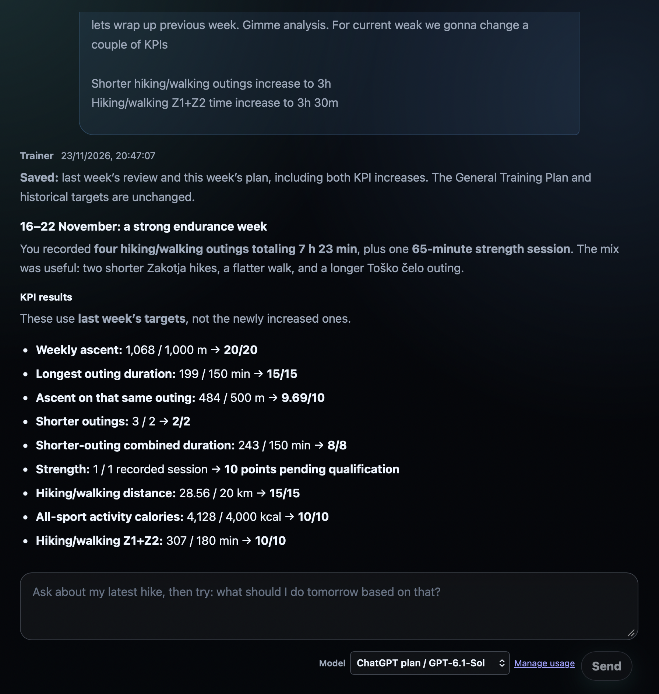
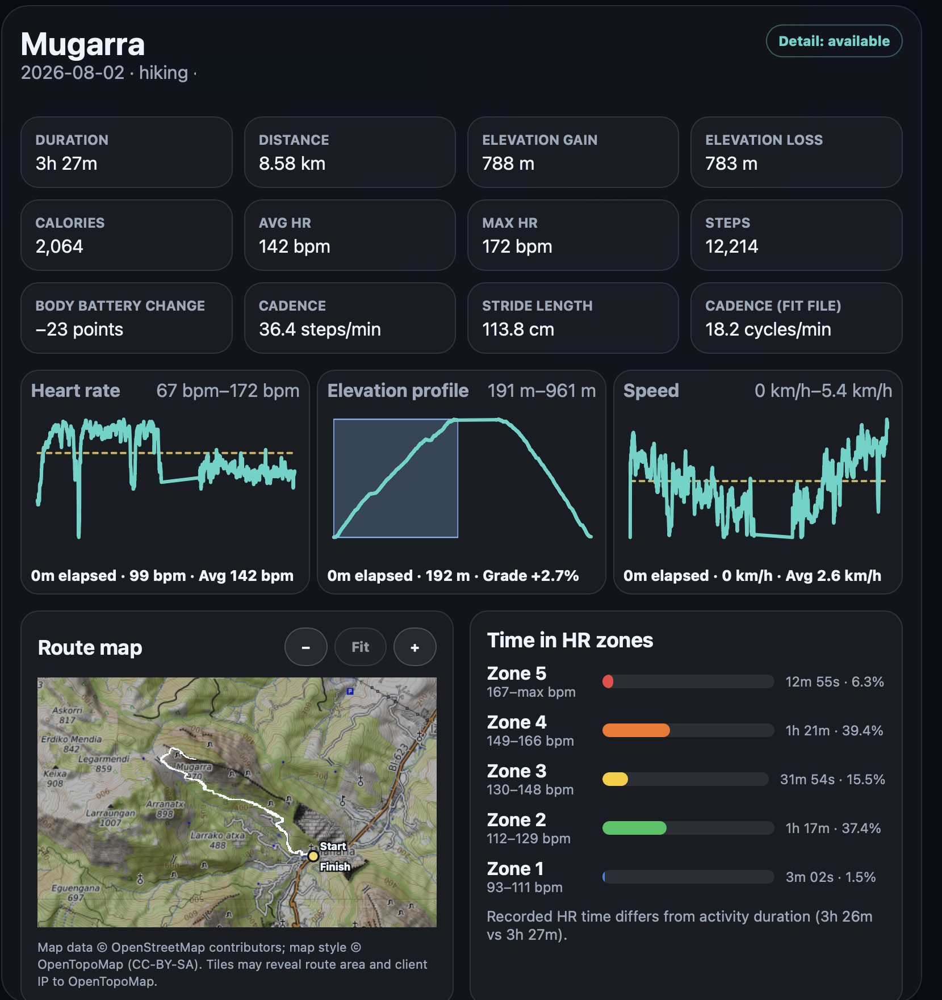
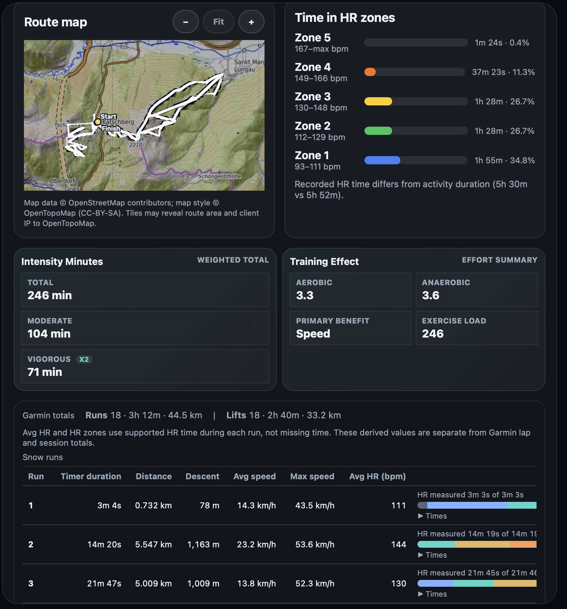
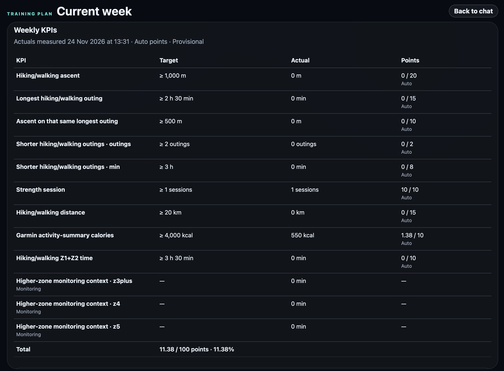
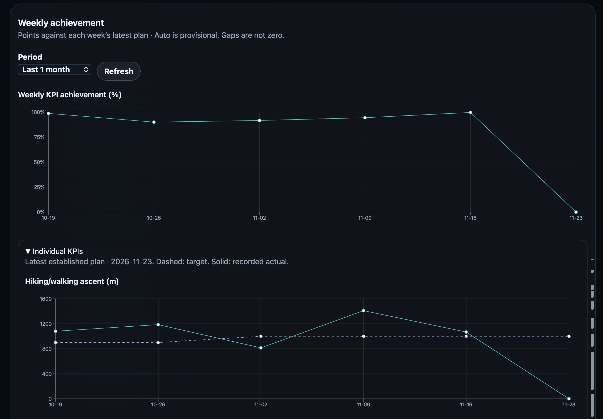
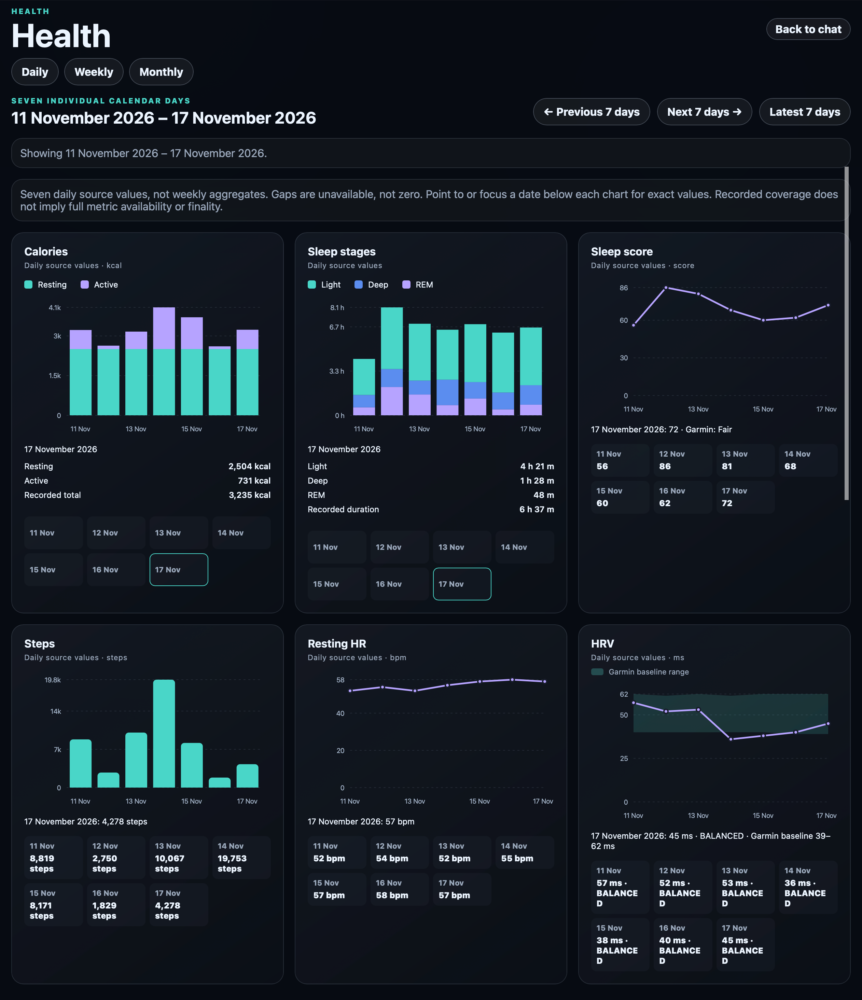
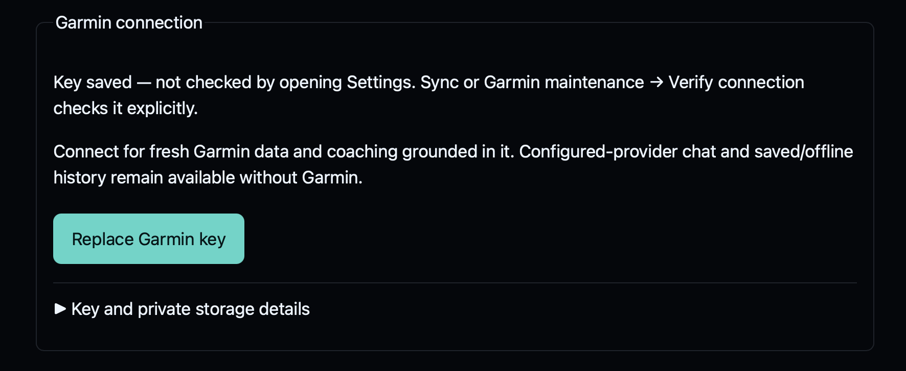

# AI Trainer for Garmin Connect

**A private AI coach that answers from your own Garmin history.** It runs on your Mac, keeps your data in a local database and uses the AI model you choose.

[Install on macOS](#installation) · [Releases](https://github.com/codexa-bh/ai-garmin-trainer/releases/latest) · [Privacy](#privacy) · [Status and limits](#status-and-limits)

_An independent open-source project, not affiliated with or endorsed by Garmin._



## Why it is different

- **Ask anything about your training.** The trainer runs read-only queries and calculations over your whole imported history, in every sport you record, instead of showing a fixed set of insights.
- **No black-box scores.** The app adds no readiness, recovery or difficulty score of its own. The trainer is instructed to state the criteria it used and to say when data is missing.
- **Official Garmin access.** Data comes through Garmin's Personal API with a key you create yourself. Access is read-only, and the app never asks for your Garmin password.
- **Local data, no app account.** The app stores your history on your Mac and has no server of its own. Each question sends bounded context to the model you selected; cloud models process that context off-device.
- **Your model, your cost.** Use a ChatGPT subscription, an OpenAI, DeepSeek or OpenRouter key, or a local Ollama model. The app never switches provider on its own.
- **Plans checked against what you did.** Agree weekly targets in chat. The app measures them from your Garmin data, and the trainer reviews the week with you.

It works alongside Garmin Connect, not instead of it. Your watch still syncs to Garmin; this app reads a copy and never writes anything back.

### Things you can ask

- "Compare my last three hikes. Which was the hardest, and why?"
- "Summarize all my snowboarding days this season."
- "How were my sleep and HRV in the week before that race?"
- "Review last week against the plan and draft next week with two rest days."

## What is inside

### Activities



Search your activities and open any of them: heart rate, elevation and speed charts, time in heart-rate zones, laps, a route map and Garmin's training effect. Hikes and walks get terrain sections with grade.



Resort skiing and snowboarding days are listed run by run, with lift totals.

### Training Plan





Keep one General Plan and let the trainer write weekly plans and reviews with you in chat. Each week shows its targets, the measured actual values and the points earned, with progress charts over the last one to twelve months. Say "draft only, do not save" when you want to discuss a plan without saving it.

### Health



Compare seven days side by side, or switch to weekly and monthly averages: sleep and sleep stages, HRV, stress, Body Battery, resting heart rate, VO2 max, calories, steps and intensity minutes. Missing data is shown as missing, never as zero.

## Installation

You need:

- an Apple Silicon Mac (the build targets macOS 12 or later; that minimum is not tested certification);
- a Garmin Connect account with data from a Garmin device;
- one AI model provider from the [table below](#choose-a-model).

The screenshots show a newer source build. The latest published release, 0.1.4, is still named _Garmin Trainer_; the new name will appear in a future release.

1. **Install.** Run this in Terminal:

   ```bash
   curl -fsSL https://raw.githubusercontent.com/codexa-bh/ai-garmin-trainer/main/install.sh | bash
   ```

   [`install.sh`](install.sh) downloads the latest release, verifies its published checksum and copies the app to Applications. It needs no `sudo` and does not touch your data.

2. **Open the app** from Applications.
3. **Follow the first-run Settings.** Create a new database, then add a model provider. [Settings](docs/settings.md#first-run-and-settings) explains each step.
4. **Connect Garmin.** Create a Personal API key in Garmin Connect (Settings → Personal API key), paste it into Connect Garmin, finish, then quit and reopen the app. [Garmin connection](docs/garmin-auth.md) has the details.
5. **Import your data.** Open Sync and choose Sync latest, then Import older data for your history. A long history can take several runs.
6. **Ask.** Pick a model under the chat box and ask your first question.



You can also download the `.dmg` from [Releases](https://github.com/codexa-bh/ai-garmin-trainer/releases/latest) and copy the app to Applications yourself. The app is not signed or notarized, so macOS may refuse to open a copy downloaded in a browser; use the Terminal install if it does.

### Choose a model

| Provider             | What you need                         | Good to know                                                                                            |
| -------------------- | ------------------------------------- | ------------------------------------------------------------------------------------------------------- |
| ChatGPT subscription | A ChatGPT plan; sign in from Settings | Uses your plan's usage, with no API key. [ChatGPT access](docs/chatgpt.md)                              |
| OpenAI API           | An API key                            | Billed by OpenAI per use, separately from a ChatGPT plan                                                |
| DeepSeek             | An API key                            | Billed by DeepSeek per use                                                                              |
| OpenRouter           | An API key                            | Privacy and reliability depend on the model. [OpenRouter](docs/local-runtime.md#opt-in-openrouter-chat) |
| Ollama               | Ollama running on this Mac            | Chat requests stay on your Mac. You install and manage Ollama and its models yourself                   |

There is no default model and no automatic fallback. How well the trainer works depends on the model: it must call tools reliably, which small local models may not do.

### Upgrading

There is no auto-update. Quit the app, then run the install command again; it replaces the app and leaves your data alone. Retain a compatible prior app and verified database/settings backups. Versions up to 0.1.4 were named _Garmin Trainer_; installing the renamed app does not replace that app automatically. Both names use the same data and settings; do not run them together. See [installing a release](docs/release.md#installing-a-published-release--only-after-an-actual-authorized-release).

**A version that changes the database format needs a manual upgrade first.** The app never upgrades your database on its own, and today the upgrade runs from a source checkout of that version. Back up your database, then follow [database upgrades](docs/release.md#existing-database-upgrades-and-recovery). The release notes say when an upgrade is needed.

## Privacy

- **Stored on your Mac:** your Garmin data, chats, plans and profile, in a database file at a location you choose. The app has no account, telemetry or server of its own.
- **Sent to Garmin:** read-only requests to Garmin's Personal API with your key. The app never asks for your Garmin email, password or verification code.
- **Sent to the AI model:** your question plus bounded context: your profile, the conversation and the data the trainer looks up for it. With supported models, requested activity-panel images (including route maps) may also be sent. With a cloud provider this leaves your Mac. Chat titles and memory use a model you select separately, even when chat uses local Ollama. Your Garmin key, the database file and raw activity files are never sent.
- **Sent to OpenTopoMap:** opening an activity with a route loads map tiles, so the map server sees which area you are viewing.
- **Keys are stored in plain text** in an owner-private settings file, not encrypted storage or the Keychain. Backups, privileged processes and other programs running as you can read it.
- **Memory across chats is off by default.** When it is on, deleting a chat does not clear what the trainer already remembered; clear it in Memory. [Memory](docs/memory.md)
- **Local debug traces** can contain your chats and Garmin data. Do not share them.

Run the app only for yourself on your own Mac. It has no sign-in of its own, and other programs running as your macOS user can reach it, so do not expose it to a network or through a tunnel. Chats and profile, Garmin data, plans and memory are deleted separately; read [data lifecycle](docs/source-beta-readiness.md#local-data-lifecycle) before deleting anything.

## Status and limits

- **Early software.** Version 0.1.x, built by one developer.
- **Apple Silicon Macs only.** The [Windows x64 alpha](docs/windows.md) is experimental and unsupported.
- **Unsigned.** The download is not signed or notarized.
- **Garmin's Personal API is new.** It may change, keys can expire or be revoked, and its rate limits are not fully documented. [Garmin access risk](docs/garmin-risk.md)
- **Personal use only.** Garmin offers the Personal API to individuals for their own data. Hosting this app for other people or sharing a key is not supported.
- **Read-only.** The app does not send workouts, plans or settings to Garmin or to your watch.
- **Not medical advice.** Answers come from an AI model and can be wrong, even when they cite your data. [How the trainer is instructed](docs/coaching-instructions-and-sources.md)

Found a bug? Open an [issue](https://github.com/codexa-bh/ai-garmin-trainer/issues). Never paste keys, debug traces or database files into an issue or a screenshot.

## Build from source

Install Git, Node 22 or later with npm, the Xcode Command Line Tools, Rust and Python 3.12 ([pinned versions](docs/validation.md#local-tool-setup)).

```bash
git clone https://github.com/codexa-bh/ai-garmin-trainer.git
cd ai-garmin-trainer
npm ci
npm run desktop:build
open 'src-tauri/target/aarch64-apple-darwin/release/bundle/macos/AI Trainer for Garmin Connect.app'
```

The app is configured only in its Settings; `.env.example` documents variables for maintenance scripts, not for the app. [Desktop](docs/desktop.md) covers the build, private storage and recovery, and how to [use an existing database](docs/desktop.md#explicit-private-state-adoption).

`npm run validate` runs the quality checks, tests and build after the pinned tool setup. A passing build does not show that Garmin or a model provider works; [validation](docs/validation.md) explains what each check proves.

## Documentation

Read the guide that owns the area you are changing:

- [Architecture](docs/architecture.md), [design](docs/design-choices-and-boundaries.md), [component index](docs/component-responsibilities.md).
- [Settings](docs/settings.md), [desktop](docs/desktop.md), [runtime and models](docs/local-runtime.md), [ChatGPT](docs/chatgpt.md).
- [Sync and Health](docs/sync-and-health.md), [Garmin fields and backfill](docs/garmin-extra-data.md), [key handling](docs/garmin-auth.md).
- [Memory](docs/memory.md), [summary protocol](docs/cross-chat-summary.md), [conversation history](docs/conversation-history.md).
- [Training Plan](docs/training-plan.md), [KPIs](docs/weekly-kpis.md), [coaching and sources](docs/coaching-instructions-and-sources.md).
- [Validation](docs/validation.md), [developer duties](docs/developer-process.md), [smoke playbook](docs/dev-bridge.md), [smoke inputs](docs/smoke-inputs.md). Find smoke commands with `npm run smoke:help -- search <terms>`.
- [Release](docs/release.md), [release notes](release-notes/releases/), [note format](release-notes/README.md), [redistribution](docs/redistribution.md), [readiness and data lifecycle](docs/source-beta-readiness.md).

## License

Own code/assets: [Apache-2.0](LICENSE); releases up to 0.1.4 remain MIT. Dependencies, names/logos/maps retain their terms; [license scope](docs/redistribution.md#first-party-license).

Garmin and Garmin Connect are trademarks of Garmin Ltd. or its subsidiaries. ChatGPT and OpenAI are trademarks of OpenAI. This project is not affiliated with, endorsed by or sponsored by either company.
