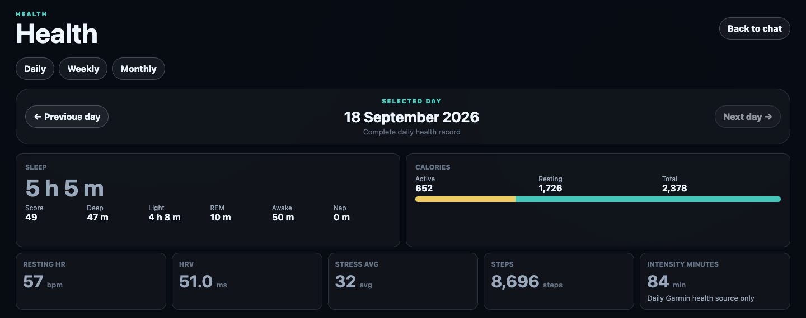

# AI Garmin Connect Trainer

A local-first training companion with public source: import your Garmin Connect history, explore activity and recovery trends, and chat with a coach grounded in your data.

- **Trainer chat** — streaming answers using normalized Garmin data, guarded read-only SQL/math tools, and conversation context.
- **Activity Dashboard** — searchable synced activities with summary stats, heart-rate, elevation, speed, and other available detail charts.
- **Health** — daily metrics plus weekly/monthly rollups for training and recovery context.
- **Personalization** — an editable Profile and General Plan, chat-confirmed weekly plans/reviews with original commitments and secondary history, and inspectable stable cross-chat memory with manual/Forget/Refresh controls, without embeddings.
- **Provider choice** — direct DeepSeek/OpenAI, explicit loopback Ollama chat, or opt-in OpenRouter. Cloud providers receive bounded chat/Garmin context; local storage does not mean all AI processing stays on your machine.

**Local-only, single-user, no app sign-in.** Run on loopback only; do not expose it on your LAN, a public host, or a tunnel. Garmin data comes from Garmin's official **Personal API** with a key you create for your own account; it is a new API that may change, and a key can expire or be revoked. The source repository is public; source availability is not release, deployment, or beta approval. [0.1.4 is stable/Latest](https://github.com/codexa-bh/ai-garmin-trainer/releases/tag/v0.1.4), with macOS ARM64 and **Windows x64 alpha** downloads from one reviewed source. Both are unsigned; macOS is not notarized. See [download identities and qualification limits](docs/release.md#published-014).

[Installation](#installation) · [Desktop runtime guide](docs/local-runtime.md) · [Garmin authentication](docs/garmin-auth.md) · [Safety and privacy](#safety-and-privacy)

## Screenshots

Actual desktop views of the running local app with operator-authorized data. These are examples, not demo fixtures or guarantees of coaching accuracy. Click an image for full size.

### Trainer chat


A bounded excerpt from an existing conversation, with a structured answer based on imported activity history. No new prompt was sent for this capture.

### Activity Dashboard


Search synced activities and inspect available normalized detail. This crop shows the summary and charts above the route-map section.

### Daily Health



Browse imported daily health records; coverage and values depend on what Garmin provides. Today's values are not necessarily final.

### Monthly Health


Compare period averages with labeled charts and per-period values. Weekly rollups are available in the same view.

Captured on 18 September 2026 from the loopback development app at a 1440-pixel desktop width. Dashboard/Health images are cropped for focus; no displayed metrics were altered. Screenshots may lag later UI changes.

## Installation

The supported product is the **local macOS ARM64 Tauri app** with bundled Node. Standalone browser development/start/restart/bootstrap support has been removed, including its wrappers and automatic Ollama preparation. Next.js remains internal desktop rendering/backend/build technology, not a second product launch path.

The **[0.1.4 dual-platform release is published](https://github.com/codexa-bh/ai-garmin-trainer/releases/tag/v0.1.4)**: macOS ARM64 plus **Windows x64 alpha**, sharing one version/tag/reviewed source. [Download links and checksums](docs/release.md#published-014) were verified anonymously in full. The unsigned per-user Windows installer has **Windows Server 2025 x64 CI-only** qualification, not Windows 11/ARM, trusted-native-input, normal onboarding or real-service certification. See [Windows alpha limits](docs/windows.md) and the [dual-platform release procedure](docs/release.md#dual-platform-candidate-and-publication-procedure). Other platforms remain unsupported.

This advanced-user setup from the **public repository** is cross-checked against scripts, not clean-machine certification. Follow [desktop build, private-state adoption and recovery](docs/desktop.md) too. The **[0.1.4 stable/Latest macOS ARM64 download](https://github.com/codexa-bh/ai-garmin-trainer/releases/tag/v0.1.4)** is available, unsigned and not notarized. The [release runbook](docs/release.md#published-014) records both platforms' exact source/checksums and separates manual downloads from source builds. Neither is clean-machine or real-service certification. Existing-data upgrades still require matching source CLI/dependencies, stopped owners and verified backups.

### 1. Install prerequisites and build

Install **Git, Node.js 22+ with npm, Xcode/Command Line Tools, Rust/Cargo**, plus Python 3.12 only for the developer build/validation scripts (see [local tool setup](docs/validation.md#local-tool-setup)). The app itself needs no Python, uv or uvx: Garmin access and activity-file decoding run inside its bundled Node. Optional Ollama stays separately managed. Desktop never installs external software or starts/downloads models.

```bash
git clone https://github.com/codexa-bh/ai-garmin-trainer.git
cd ai-garmin-trainer
npm ci
npm run desktop:build
open 'src-tauri/target/aarch64-apple-darwin/release/bundle/macos/Garmin Trainer.app'
```

Source reads/clones need no GitHub account. Pushing requires repository authorization. Run source commands from the checkout. `desktop:dev` rebuilds production backend resources and opens the native development host; there is no browser dev server or HMR.

### 2. Enter Settings

First launch opens **Settings**, also available from the native app menu even without a working backend. Desktop no longer loads/selects/discovers env files or its old configuration pointer. Upgrading users must re-enter settings; original env files, DBs and old Garmin token files are not imported, moved, changed or deleted.

A genuinely blank installation opens a guided **Data → Provider → Connect Garmin or continue → Review** wizard. Explicitly choose **Create new database** (unused destination only) or **Use existing data** (compatible SQLite only). Native proposes an owner-private platform app-data destination outside the checkout. No history date is required: explicit Sync starts with recent data and continues older discovery in bounded batches. Under **Garmin history**, enable **Limit how far back to import** only to choose an explicit **Import from** date. The date is hidden while Off; turning the limit off and saving returns to automatic discovery after quit/reopen. Create new initializes the authoritative current schema in memory, then exclusively publishes the new file without overwriting files, sidecars or leases. Existing selection and ordinary startup never create, migrate or adopt a missing/old/corrupt/owned database.

Use canonical absolute paths, not aliases, shell expansion or cwd-relative paths. Custom new destinations need an existing owner-private parent. For existing data, first evaluate on a WAL-consistent populated disposable backup. Choose Connect Garmin or Continue without Garmin; configured-provider chat and saved/offline history do not require Garmin.

Provider keys are entered only in the local settings window and stored by native code in an **owner-private plaintext settings file** (folder `0700`, file `0600`). This is not encryption: the same user, privileged processes and backups can read it. Reads show masked status, never saved values. Untouched fields keep prior keys. A fixed mask indicates saved presence, never the key’s length or value. Type or paste to replace; Backspace/Delete on the mask marks removal, applied only on explicit Save. Legacy Keychain settings require explicit one-time **Adopt referenced Keychain keys once**, or private re-entry of every configured slot. Startup/reads/saves never access Keychain; denied adoption does not auto-retry. Original settings and Keychain items remain unchanged. See [storage and recovery](docs/desktop.md#explicit-private-state-adoption). **Memory → Remember across chats** controls startup configuration, not deletion. Choose the shared memory/automatic-title model and memory size separately from Trainer’s chat model. Save, then explicitly quit/reopen to apply memory changes. Saving On does not undo an immediate Disable in Trainer → Memory. Legacy configuration and custom executable overrides remain preserved internally, without technical editors or a diagnostic status section in normal Settings.

- **Chat model catalog** separates ChatGPT subscription from OpenAI API key, DeepSeek, Ollama and OpenRouter. One active ChatGPT connection has explicit Switch account; legacy multi-connection state requires a one-time choice and old records remain private for recovery. Subscription rows bind that exact registration and account model; other providers retain compact exact Model IDs and shared key controls. There is no configured default. Existing API-key/Ollama labels use provider / exact Model ID only; valid old names remain inert, round-trippable compatibility metadata with no name editor. Trainer remembers one explicit choice per selected SQLite DB. Keys are shared once per provider; no discovery or automatic fallback. New configurations require an explicit chat choice, even with one eligible entry.
- Ollama has equal catalog prominence; its loopback endpoint stays Advanced. Manage its daemon/models separately. OpenRouter remains explicit opt-in; review [privacy and tool-reliability limits](docs/local-runtime.md#opt-in-openrouter-chat).
- Explicit Save retains original settings and exact prior-choice compatibility inputs before retiring old defaults. Legacy auto projects only its determinable prior DeepSeek-first/OpenAI-by-key selection, never continuing failover. Extraction/title compatibility and embeddings stay independent.
- **[ChatGPT subscription](docs/chatgpt.md)** uses native Continue with ChatGPT, private system-browser authorization, explicit account models and plan/credit accounting, without an OpenAI API key or borrowed Codex credentials. Connection commit and catalog Save are separate; no automatic paid fallback.

On a genuine first run, **Finish and open Trainer** validates local settings/required keys, saves private file settings and starts one verified owned backend in the same session. This proves local configuration, not remote funding/model/network availability; there is no provider probe, automatic fallback or automatic Garmin sync/login. Ollama remains separately managed. If setup fails, read the reported commit state: a published DB, saved settings or independently verified tokens are retained, not rolled back. **Retry opening saved Trainer** uses the committed configuration only; after interruption before settings commit, explicitly select the retained DB with Use existing data.

For an existing installation, **Save settings** commits privately, then live-applies only chat catalog and shared provider-key changes to the owned running backend. Confirm the reported result: Applied, saved/not applied, or saved/live outcome unknown. Reload reconciles active versus saved state without retrying Save. Other settings (including DB/Garmin account, endpoints and memory topology) still need explicit quit/reopen. A confirmed Save that changes effective startup-only settings still pending activation shows a dismissal-only **Restart required** dialog. Unchanged/repeated and live-only Saves do not repeat it, even with older pending changes; restoring active values does not require it. Dismissal never restarts the app. Ordinary saves never start/restart a backend or switch a live DB/Garmin account. Invalid/unsupported saved settings are preserved, never treated as blank-install authority. The trainer's independently saved model preference is preserved.

### 3. Garmin access

Create a **Personal API key** in Garmin Connect (Settings → Personal API key) in your own browser, then choose **Connect Garmin** in trusted native Settings, paste the key and **Save** (first run: **Finish**). Explicitly quit and reopen to use it; Save never switches a running connection. The key is stored owner-private on this device (plaintext, not encryption) and never shown again, logged or sent to AI; keep it out of chat, screenshots and issues. Existing installations from the earlier unofficial connector show **Reconnect needed**: their saved history stays available and old token files are left untouched. See [connection and key handling](docs/garmin-auth.md). Sync also imports sleep sub-scores, HRV baseline, VO2 max, Body Battery, stress breakdown, per-lap HR zones, running dynamics and snowboarding summaries for the trainer; existing history gains them only through an explicit backfill ([additional Garmin data](docs/garmin-extra-data.md)).

Settings shows **Key saved** or **Not connected**, never key validity. **Sync → Garmin maintenance → Verify connection** is the only explicit check. Failures are reported at the requested action as a rejected key (create and save a new one), rate limiting or network/service unavailability (retry later), with no automatic retry. Saved/offline data remains usable without Garmin, and native Settings remains reachable from the app menu even without a backend.

Garmin reads are read-only HTTPS requests to the fixed official origin with memory-only bearer tokens; activity files are decoded in-process. Garmin enables fresh Garmin data/coaching but does not gate chat or offline history. No app-access sign-in is required; Garmin access/sync is never automatic at startup.

### 4. Explicit non-serving maintenance only when needed

The retained `doctor` and `db:status` tools use deliberately authored checkout env/process configuration; **they do not read private native Settings, the Garmin key or legacy Keychain**, and never contact Garmin. `.env.example` is a maintenance CLI reference, not desktop onboarding. Do not overwrite existing private env files. Never paste their values into chat/issues.

For existing-data schema upgrades (or separately chosen CLI creation), quit every owner of the explicitly approved target, preserve a verified WAL-aware backup, rehearse on a disposable copy and obtain separate primary-mutation approval. Then use the existing discrete CLI, not desktop startup:

```bash
DATABASE_PATH='/absolute/approved/trainer.sqlite' npm run db:status -- --json
# Only after approving the exact stopped/backed-up target:
DATABASE_PATH='/absolute/approved/trainer.sqlite' npm run db:migrate
```

`db:migrate` uses process environment only, not dotenv; it may create the explicitly selected target or back up an old populated schema before upgrade. Keep path-bearing output private. No automatic downgrade, copy-back, reset, primary cutover or browser fallback. See [data lifecycle](docs/source-beta-readiness.md). Source delivery grants no app restart, installation or release.

### Optional: cross-chat memory and developer diagnostics

Native Settings → Memory offers **Remember across chats** (default Off), **Memory and automatic chat-title model** (default Unselected) and **Generated summary target (characters)** (default6000, range1000–20000; advisory generated-text guidance, not a maximum; preferences separate). Choose an exact configured catalog entry independently of Trainer chat; minimized context may leave the device through that provider. A smaller, cheaper model is usually sufficient for summaries and titles. Saved memory can be included on all configured chat routes, including ChatGPT subscription. Summary Off does not disable future title processing. See [memory](docs/memory.md) for one complete summary with Edit/Save/Cancel, automatic single-request learning/correction/consolidation plus optional extra paid Densify → complete review → strictly shorter-only use/discard, separate authored preferences, Clear/Off, deliberate whole-history regeneration and automatic next-turn adoption. History edits invalidate the whole generated text, not unrelated preferences. Regeneration replaces direct summary edits, not preferences; ordinary in-flight snapshots remain stable. Native memory settings stay restart-only. Natural-language memory privacy is interpreted by that memory model in its normal single update request; validated current-input exclusions become durable native restrictions without erasing unrelated prior. Otherwise eligible privacy prose reaches the provider; hard restrictions remain pre-transmission. Titles retain their independent unchanged legacy pre-call guard.

Ordinary chat no longer retrieves/ingests semantic vectors or requires an embedding key/daemon. Legacy records, vectors, markers and inactive settings remain preserved for local review, without lazy migration or automatic historical export. Optional Ollama chat remains independent and operator-managed. Schema25 removes ordinary-correction/Profile erasure triggers while preserving stored rows; actual Profile currentness remains separate from privacy. The schema24/25 transitions require explicit approved copy rehearsal and separately gated primary activation, never automatic startup migration. Memory uses full frozen chat pins and debounced foreground activity/catch-up. Summary, title and local compaction operations have no application-imposed spending/attempt or tokenizer/capacity-qualification gates. The selected provider controls model capacity and may refuse a request; no clipping or fallback is substituted. Observed usage, known-price estimates, historical reservations and unknown costs remain distinct, not invoices.

Local debug traces are currently always enabled by tested application policy, regardless of `LLM_DEBUG_TRACES`. Traces visible in Profile & data may include private normalized Garmin/chat/tool context; keep them local and out of screenshots/support artifacts.

## Repository guide

Start with [architecture](docs/architecture.md), then read only the detailed docs relevant to your work:

- [Design choices and boundaries](docs/design-choices-and-boundaries.md) — component responsibilities, AI reasoning, guarded SQL/math, local storage, and import boundaries.
- [Coaching instructions and sources](docs/coaching-instructions-and-sources.md) — evidence, limitations, and instruction maintenance.
- [Memory](docs/memory.md) — stable cross-chat pins, manual/control UI, shared summary/title configuration and preserved legacy review; [conversation replay/compaction](docs/conversation-history.md) and [automatic summary](docs/cross-chat-summary.md) document owners/bounds. The [accepted redesign contract](docs/memory-redesign-contract.md) and [synthetic scenarios](docs/memory-redesign-acceptance.md) define evidence, not blanket passes. Schema20 and restart-only settings require separate activation; source delivery activates no primary data.
- [Validation](docs/validation.md) and [developer process](docs/developer-process.md) — local smoke, same-task data back-sync, and task-created data cleanup.
- [Local macOS desktop runtime](docs/desktop.md) — bundled resources, native lifecycle, private file settings/adoption, private sign-in, external integrations and rollback.
- [Local smoke inputs](docs/smoke-inputs.md) — representative authored synthetic defaults and optional exact reusable private authority; no personal-input discovery or recurring nightly expansion.
- [Native smoke playbook](docs/dev-bridge.md) — run `npm run smoke:help -- search <terms>` or `show <id>` for relevant commands, effects and evidence limits without reading all scenario contracts. Discovery is read-only; ordinary/debug/fixed-presentation/real-service proof remains distinct. [Bounded extensions](docs/smoke/protocol.md#task-needed-bridge-and-runner-extensions) remain expected within authorized work, not a permanent capability ceiling.
- [Dual-platform release runbook](docs/release.md) — version/notes, same-artifact verification, explicit draft/publication, manual placement and advanced existing-DB upgrades; [redistribution material and release conditions](docs/redistribution.md) cover the first-party license scope and actual notice/source resources.
- [Source readiness and data lifecycle](docs/source-beta-readiness.md) — supported boundary, backup/restore, diagnostics, and dependency evidence.

Key code entry points are `src/app/trainer-dashboard.tsx`, `src/app/style.css`, `src/app/api/`, `src/lib/ai/`, `src/lib/garmin/`, and `src/lib/memory/`.

## Runtime trainer model

Trainer navigation uses **Profile & data** for editable Profile, imported athlete/body facts, diagnostics and deletion. **Sync** owns explicit connection verification, import-summary refresh and activity-detail maintenance; Memory remains separate.

Chat's compact **Model** selector (accessible name **Trainer model**) lists locally eligible activated catalog entries with provider/exact-ID labels. Missing-key cloud entries are omitted; eligible keyless Ollama entries remain. An unavailable selected identity stays explicit, never visually or persistently replaced by the first eligible choice. With no eligible entries, configure provider keys/models in native Settings, confirm live application and retry availability. Saving an eligible identity affects subsequent trainer turns without restarting; running turns retain their captured model/configuration. The app-wide preference persists across reloads/restarts. There is no Default/Reset action. Deleted/missing-key/invalid choices stay unavailable until explicitly replaced, with no provider-only remapping or silent substitution. One-time durable compatibility preserves prior exact saved/legacy/default intent without overwriting original preferences; a new configuration remains unselected.

Eligibility means local configuration, not account funding, installed models or remote readiness. The chat control never exposes/edits keys or changes the shared summary/title selection. Native Settings owns private updates; catalog/keys can apply live after exact acknowledgment. Captured chat, memory and deferred-title work retain their admitted credentials; other configuration stays restart-only. See [local runtime](docs/local-runtime.md#runtime-trainer-model-preference).

## Weekly plans and reviews

Training Plan opens to **Current week**, using your device's Monday–Sunday calendar. **Next week** exposes the following week (including plans prepared on Sunday); **General Plan** retains the existing independent manual editor. Saved general plans remain usable; more than 60 elapsed days since revision offers an optional review cue, not an expiry or automatic rewrite. **History** loads bounded summaries and individual past documents, not an entire archive.

Create or revise General Plan, weekly plans and reviews directly in chat using the general template, current Garmin evidence and your feedback. No mandatory preview or confirmation turn is required. Ask for **draft only, do not save** when you want discussion without persistence. Complete current reads, conflict/privacy/calendar checks and exact targeted edits still apply. A review and next plan save atomically together; a separate General Plan update is not part of that transaction. The trainer reports each actual save or failure.

New weekly drafts include concise model-selected KPIs with targets, units and full-target points totalling **100**. Structured saves omit duplicate explanatory essays; non-obvious scoring rules, real substitutions/extra credit and actual evidence limitations retain only their necessary explanation. Reviews compare actuals with the **latest established plan** and name its exact KPI set; superseded targets are not competing scoring bases. Useful, relevant extra work can exceed 100, with explained partial substitution credit, no double-counting and unmet specific goals still visible (cycling kilometres are not hiking kilometres). There is no fixed app-authored scoring formula. Saved scorecards show the agreed targets and evidence. Optional declared proportional/threshold/per-unit rules fill unreviewed numeric points from stored measured actuals; reviewed awards, including zero, win per track. Auto-containing totals are provisional. Rules never infer eligibility, weights or bonuses.

Training Plan shows the latest saved plan and a compact **KPI | Target | Actual | Points** grid with one total. Each scored measurement has its own points; monitoring is not scored. Qualification remains accessible in concise row disclosures. Current/next Plan notes open by default at full grid width; History shows Review notes before Plan notes, both closed by default. Older documents and exact assessment references remain stored, not presented as alternative baselines. Reopening Training Plan refreshes saved data and returns to **Current week**. Routine Reload controls are removed; navigation and successful saves refresh saved reads, with Retry only on failure. Loaded history remains available when returning to History. Entering General Plan also refreshes its saved snapshot; unsaved editor input survives navigation and refresh, and Cancel restores the current saved snapshot. Navigation never saves edits.

Current/upcoming revisions establish the latest targets; narrative/review-only saves do not themselves manufacture a new KPI set. Legacy review-defined scores are provisional and displayed only with an explicit source binding to that week's latest plan. No recorded plan means no completion score; missing evidence is unavailable, not zero. Partial-week progress retains the latest plan's denominator and human-readable cutoff, without rewriting assessments or an obsolete-assessment fallback. The narrative snapshot at review save is contextual metadata, not a KPI target reference.

**Measured actuals** keep the current week current without a review. Once a calculable KPI is agreed, the trainer saves a reusable read-only SQL measurement, which the app checks against this and the previous week before accepting. A completed Garmin sync, **Refresh** in Progress, or the trainer's default measurement refresh recomputes actuals for this and the previous week from imported local data, whatever period is shown. A newly verified measurement publishes its target week. If this week has no plan and the previous week was not refreshed, Progress shows “No plan for this week”. The grid and charts show these stored actuals. Reviewed points and reviews stay unchanged; declared rules derive provisional points without saving scores. A successful current-week KPI plan save also best-effort refreshes that week's measurements once; upcoming/review-only saves do not. Reused identities carry agreed rules unless explicitly changed. A failed measurement keeps its last value, marked stale. Ask the trainer to recompute one explicit week within the 12-week window for an older late import or correction.

Historical plans are read-only. Sunday is not automatically a finished week. Late evidence or corrections require fresh evidence and a newly saved review through chat; existing documents are not automatically rescored or rewritten. Saved date ranges/calendar bases never silently shift with a device timezone change. No workouts, background reminders, automatic saves or Garmin write-back are introduced.

**Progress** opens with saved weekly KPI achievement: achieved / available points and the arithmetic percentage against each week's latest targets. Unknown totals remain gaps; true zero and explained above-100 results remain visible. This is plan achievement, not fitness improvement. All numeric charts from the latest established plan open together, independently of the selected period (Last 1 / 2 / 3 / 6 / 12 months; default 2 months), and join equivalent history by stable identity/meaning. One Period dropdown immediately reloads every chart, without date inputs or a Load/Apply button. Each chart is keyboard-focusable with nonvisual exact values and cutoff/qualification; there are no KPI/measurement selectors, Week details or raw-values panel. The pane scrolls through the last chart at short and narrow window sizes. KPIs remain chat-managed only. Schema26 adds structured storage; preserved historical Markdown is labelled source, not a second current value store. See [structured weekly KPI contracts and separately gated migration](docs/weekly-kpis.md).

Weekly artifacts, structured KPIs and the general template survive chat/Profile and Garmin deletion. Chat deletion does not delete saved documents. Legacy pending proposal storage is preserved but is not exposed to the model or automatically applied. Schema upgrade is additive; use the explicit backed-up migration procedure above. Source delivery does not upgrade a running database automatically or authorize a restart.

## Daily-health freshness

**Sync latest** refreshes recent health/activity/body facts and baseline/detail supplements without advancing or resetting saved historical exploration. **Import older data** starts explicit exploration within the current automatic or selected scope; **Continue historical import** appears only for verified executable saved work. A history record or unknown remote boundary alone is not backlog. Completed selected ranges stay completed after repeat refresh/reload. Processed activity records and refreshed health dates are upsert counts, not proven new records; stored totals remain separate.

One explicit Sync drains all eligible known activity details, including activities admitted later during historical import. There is no per-run detail-count quota or default selection ceiling. Available/partial/unsupported detail is terminal, not repeatedly fetched. Failed attempts stop safely rather than retrying in a loop; attempted, completed and remaining known details are distinct. The visible current phase and incomplete reason/next action remain outside Technical details. Latest/history results and reload share additive `garmin_sync_v1` operation truth; legacy absence is unknown, not proof of exhaustion. Cancellation and safety stops retain their actual incomplete status in `sync_run`, not completed. An internal pre-dispatch batch boundary continues automatically within the same claim; in-flight timeouts and cumulative limits do not reset.

Historical import refreshes recent facts once and advances fair health/activity/body/repair batches in one foreground operation, up to **30 minutes or 480 cumulative HTTP requests**, with at least one second between serial dispatches. Each internal batch retains **96 requests / 180 seconds**, each request **30 seconds**. Daily health is read in documented date ranges (31 days for sleep/body battery, up to a year for summaries/HRV), so one range read covers many dates; the counts are actual Garmin HTTP requests, not a proven service allowance. Startup, nested reads and pacing share the non-resetting operation clock. The trainer tool and bodyless legacy HTTP callers retain their existing bounded semantics but refuse saved progress whose scope differs; the dashboard always sends an explicit latest/history/discover intent. Concise results and next work stay visible; **Syncing…** and a decorative spinner identify local or currently confirmed server activity (static cue with reduced motion). Stale metadata and interrupted saved outcomes are not live activity. Collapsed **Technical details** holds run-specific sanitized logs and cursor/count facts, not standing policy paragraphs; older-history attention stays visible independently of latest success.

Discovery reads year-long daily-summary ranges (up to 364 days per request, never below a selected limit) and prioritizes dates with wellness data. Under a selected date limit, empty dates never skip reads. Under **automatic discovery**, each historical batch first probes the next older year; when a full year has no wellness data, discovery stops at the oldest date with data (`noDataBefore`) and Sync shows **Older history complete — No Garmin data found before <date>** with no Continue button, instead of checking empty days one by one. This is a practical stop for the connected account's daily summaries, not a certified account inception; data that only exists before a whole empty year is not explored automatically. Family cursors remain independent. **Cancel sync**, disconnect or app exit stops dispatch and owned work, retaining committed data. Restart and safety pauses require explicit **Continue historical import** when saved work is actionable; setup Finish, launch, navigation and summary reads never start discovery. Authentication/rate/protocol/storage failures and no safe progress stop automatic admission without retries. Refresh summary after cancellation/lost response before another action; failed/stale summary blocks replay. A live server claim still refuses overlap. Persisted running without a live claim is interrupted, not a permanent lock.

The durable summary separates checked older dates, dates with metrics, oldest imported date and unresolved work. Empty dates and activity exhaustion never prove earliest remote health: that boundary remains **unknown**. Existing valid saved dates remain optional advanced exploration limits (not coverage proof); clear the field and explicitly relaunch to select automatic discovery. Old global forward checkpoints are retained but never interpreted as reverse cursors. Family progress remains in `garmin_history_v1`; separate additive `garmin_discovery_v1` stores minimized hint provenance, queued candidate dates and historical operation phase/attempts/batches/stop reason. Additive `garmin_latest_v1` retains latest-refresh settlement/counters independently; summary reads never write checkpoints. When settings switch from a saved date limit to automatic discovery, valid settled or paused limited progress offers one explicit **Discover older history** action: it keeps family cursors, counters, unresolved work and imported data, commits the history/discovery scope change atomically under the Sync claim and continues older than the old limit (a frozen activity window keeps its original lower bound until it finishes; a steps hint that already passed the old limit is re-read once from just below it). Summary reads, launch and Sync latest never transition. Other date-limit changes, disagreeing/one-sided checkpoints and failed/no-progress history show a short specific reason without an executable recovery action. Unsupported/corrupt checkpoints refuse rather than reset. Existing normalized records and date-keyed weight history are preserved. A source rollback can ignore the new checkpoint but must preserve DB/backups; the older exhaustive importer has its own behavior and is not a bounded-sync substitute.

Health **Daily** compares seven consecutive calendar dates as individual source
values, not a weekly aggregate. Previous/Next step seven dates (including gaps);
Latest returns to the newest imported date at or before today. The range survives
tabs, away/back and overlapping post-sync refreshes. Missing records/fields and
outside-loaded history are explicit, and today is marked in progress on the UTC
sync calendar. Responsive metric charts retain all seven date slots, with exact
source values available by pointing to, focusing or tapping the date buttons.
Calories combines resting (below) and active in one stack with a shared exact
breakdown and independent recorded total. Incomplete breakdowns omit the stack;
known values remain available, and differing component sums are explicit.
Sleep stages combine REM (bottom), Deep and Light (top) in one absolute-duration
stacked-bar card in Daily, Weekly and Monthly, with a shared exact readout that
shows the independently recorded sleep duration. The order is a display choice,
not a ranking of sleep quality. Weekly/Monthly show each stage's existing daily
average over its own available days. An incomplete breakdown omits the stack,
known values stay readable and a differing stage sum is stated, never reconciled;
Awake, Nap and sleep score remain separate charts.
Collapsed per-date details preserve source coverage and categorical HRV context;
gaps are not interpolated or filled with zero. Weekly/Monthly calculations and their bounded imported input remain unchanged.

**Sync latest health finality** is independent of metric completeness and uses Garmin's own daily coverage. An ended desktop-local calendar day becomes operationally final only when its daily summary reports wellness coverage for the whole local day (its local start at midnight, its end at the next midnight, consistent GMT offsets including 23/25-hour DST days) after that day has ended and its normalized download succeeded. Partial, malformed or missing coverage keeps the day mutable; today stays mutable. Coverage is evidence that Garmin holds the whole day, never proof of a particular watch upload. Final complete, partial and recognized source-empty days are skipped across restarts; missing fields remain missing. Non-final dates and the complete forward tail remain eligible without a 14-day cutoff, within the exploration floor and normal operation limits. The first official-reader run over data imported by the earlier connector rechecks the most recent 14 local dates (and any non-final ones), keeps older upload-based finals as legacy-final and leaves other data untouched. Refreshes preserve prior non-null metrics and valid zero/downward corrections. Coverage finality is operational, not a promise that Garmin never revises older cloud records.

Latest has no artificial dispatch spacing; serial cancellation, limits and fatal auth/rate handling remain. The single recent-activity request still covers approximately 14 UTC dates, and all required details still drain; activity details and exact HR time in zones come from each activity's original file (in-process FIT decode), falling back to the activity list's zone buckets or, with boundaries in the file, a labelled estimate. Profile/heart-rate-zone attempts occur at most once per local day across restart, including failed attempts and the body-profile path. FIT baseline runs only when the newest known activity differs from the last successful applicable FIT activity; no activity skips it. Skipped/failed sources preserve usable baseline facts. Additive `garmin_latest_freshness_v1` stores these rules without a schema upgrade or history/discovery writes. A settled same-day repeat normally needs about nine HTTP requests (one key exchange, one range read per daily source, activity list, weight and body history) and downloads no files.

## Validation

After the [pinned Python/Rust tool setup](docs/validation.md#local-tool-setup), run `npm run validate` for JS/TS, Rust format and Python format/lint/dead-code checks, deterministic tests and the production build. Routine Ubuntu PR/main CI uses `validate:ci` (including both Knip modes) without production/native builds; a manual-only `Windows x64` workflow builds/verifies the Windows foundation and runs the finite synthetic installed-render/persistence/uninstall scenario on Windows Server (not Windows 11 qualification); a change-gated 02:17 UTC macOS ARM64 nightly adds full validation/reliability/resources, warnings-denied Clippy, native tests and one synthetic Goals save/restart. Clippy is macOS-only and post-merge; Windows-only Rust is formatted but not linted. Exact reproduction, unchanged-failure skip policy and coverage limits are documented in [validation](docs/validation.md). A successful build is not proof of working Garmin authentication, remote-provider readiness, or clean-machine setup.

## Safety and privacy

- Source is publicly available at `https://github.com/codexa-bh/ai-garmin-trainer`. Public source availability does not authorize public hosting, LAN exposure, deployment, release, or beta invitations; local data and credentials must remain private.
- Local app access has no sign-in gate; loopback/private operation and local secret handling are required.
- Garmin access is read-only HTTPS to Garmin's fixed official Personal API origin with the user's own key; no Garmin writes, redirects, alternate endpoints or connector processes.
- The selected cloud AI provider receives bounded chat/Garmin context. Review provider privacy/routing settings; local SQLite storage is not an assurance of fully local processing.
- The trainer sees app-normalized summaries and bounded current-turn SQL/math or detail-tool evidence; it never sees the Garmin key, bearer tokens, token/auth/cookie fields, environment values, filesystem paths, unrestricted raw payloads, or unrestricted stream dumps.
- The configured AI provider handles medical-domain responses without an additional app-authored response restriction. Cross-chat memory has no content-pattern filter: user-authored topic words, URLs, paths, key-like strings and quoted instructions may remain untrusted discussion data, never native credential/file/tool authority. Structure, source scope and explicit no-save/privacy controls still apply.
- Profile, active chat transcript, Garmin facts, summary derivatives and preserved legacy memory are separate. New chat resets local context; each turn's admission adopts latest usable cross-chat memory or null. Summaries remain lower authority than current corrections, Profile and fresh tool evidence; ordinary publication cannot replace an in-flight snapshot. Whole-summary editing, separate preference removal, Clear and Disable retain distinct scope; no precise per-source generated-fact erasure is promised.
- Clear chat/Profile, Clear summary and Garmin deletion are separate controls; transcripts, plans, legacy stores, provider logs and backups are not erased by summary Clear. See [data lifecycle](docs/source-beta-readiness.md#local-data-lifecycle) and [memory](docs/memory.md) before deleting data or resetting Garmin access.

## License

The project's own code and assets are available under the [MIT License](LICENSE), including earlier versions. Dependencies and third-party names, logos and map data keep their own terms; see [what the license covers](docs/redistribution.md#first-party-license).
