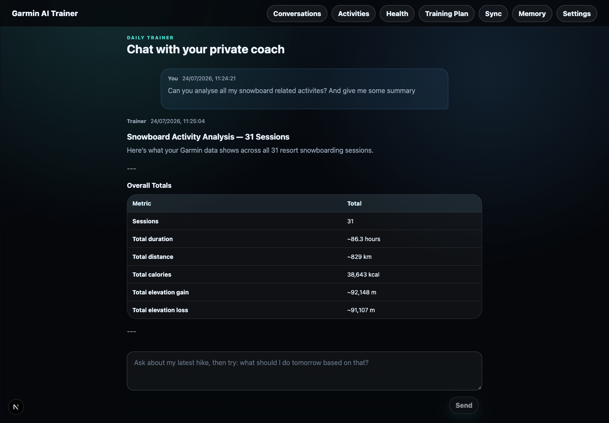
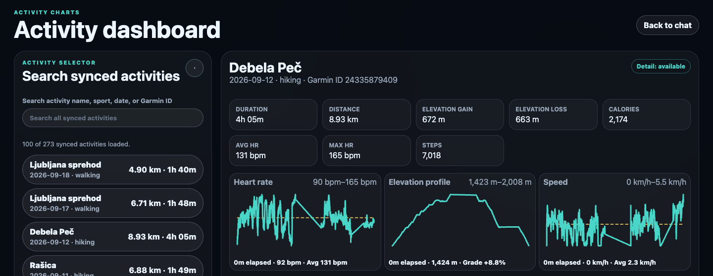
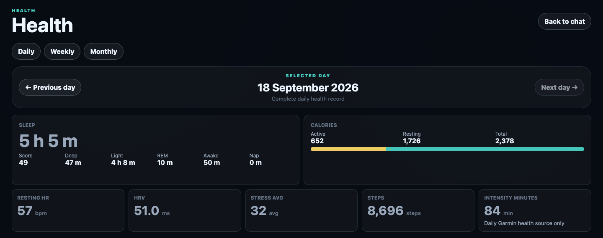
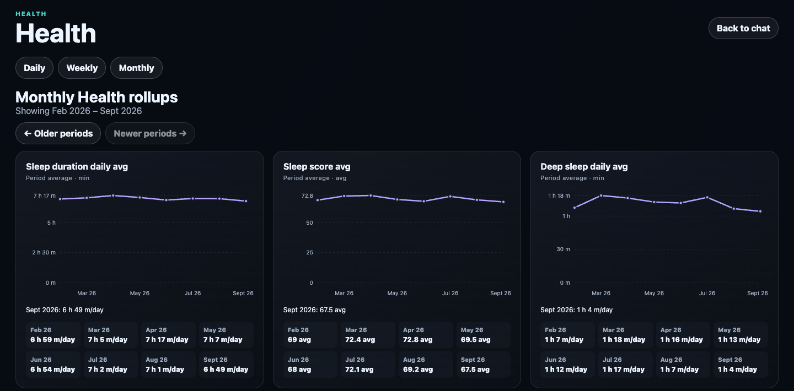

# AI Garmin Connect Trainer

A local-first training companion with public source: import your Garmin Connect history, explore activity and recovery trends, and chat with a coach grounded in your data.

- **Trainer chat** — streaming answers using normalized Garmin data, guarded read-only SQL/math tools, and conversation context.
- **Activity Dashboard** — searchable synced activities with summary stats, heart-rate, elevation, speed, and other available detail charts.
- **Health** — daily metrics plus weekly/monthly rollups for training and recovery context.
- **Personalization** — an editable Profile and General Plan, chat-confirmed weekly plans/reviews with original commitments and secondary history, and optional inspectable, editable, deletable semantic memory.
- **Provider choice** — direct DeepSeek/OpenAI, explicit loopback Ollama chat, or opt-in OpenRouter. Cloud providers receive bounded chat/Garmin context; local storage does not mean all AI processing stays on your machine.

**Local-only, single-user, no app sign-in.** Run on loopback only; do not expose it on your LAN, a public host, or a tunnel. Garmin access uses a pinned **unofficial** connector, not Garmin's official Developer Program APIs; undocumented endpoints may change or stop working. The source repository is public; source availability is not a supported packaged release, deployment, or beta invitation.

[Installation](#installation) · [Desktop runtime guide](docs/local-runtime.md) · [Garmin authentication](docs/garmin-auth.md) · [Safety and privacy](#safety-and-privacy)

## Screenshots

Actual desktop views of the running local app with operator-authorized data. These are examples, not demo fixtures or guarantees of coaching accuracy. Click an image for full size.

### Trainer chat



A bounded excerpt from an existing conversation, with a structured answer based on imported activity history. No new prompt was sent for this capture.

### Activity Dashboard



Search synced activities and inspect available normalized detail. This crop shows the summary and charts above the route-map section.

### Daily Health



Browse imported daily health records; coverage and values depend on what Garmin provides. Today's values are not necessarily final.

### Monthly Health



Compare period averages with labeled charts and per-period values. Weekly rollups are available in the same view.

Captured on 18 September 2026 from the loopback development app at a 1440-pixel desktop width. Dashboard/Health images are cropped for focus; no displayed metrics were altered. Screenshots may lag later UI changes.

## Installation

The sole supported product is the **locally source-built macOS ARM64 Tauri app** with bundled Node. Standalone browser development/start/restart/bootstrap support has been removed, including its wrappers and automatic Ollama preparation. Next.js remains internal desktop rendering/backend/build technology, not a second product launch path. Other platforms are unsupported.

This advanced-user setup from the **public repository** is cross-checked against scripts, not clean-machine certification. Follow [desktop build, private-state adoption and recovery](docs/desktop.md) too. No installer distribution, signing, notarization or release channel is provided.

### 1. Install prerequisites and build

Install **Git, Node.js 22+ with npm, Xcode/Command Line Tools, Rust/Cargo, and Python 3.12-capable uv/uvx**. Optional Ollama stays separately managed. Desktop never installs external software/Python or starts/downloads models; uv may acquire locked Python packages on explicit integration use.

```bash
git clone https://github.com/codexa-bh/ai-garmin-trainer.git
cd ai-garmin-trainer
npm ci
npm run desktop:build
open 'src-tauri/target/aarch64-apple-darwin/release/bundle/macos/Garmin Trainer.app'
```

Source reads/clones need no GitHub account. Pushing requires repository authorization. Run source commands from the checkout. `desktop:dev` rebuilds production backend resources and opens the native development host; there is no browser dev server or HMR.

### 2. Enter Settings

First launch opens **Settings**, also available from the native app menu even without a working backend. Desktop no longer loads/selects/discovers env files or its old configuration pointer. Upgrading users must re-enter settings; original env files, DBs and tokens are not imported, moved, changed or deleted.

A genuinely blank installation opens a guided **Data → Provider → Connect Garmin or continue → Review** wizard. Explicitly choose **Create new database** (unused destination only) or **Use existing data** (compatible SQLite only). Native proposes an owner-private platform app-data destination outside the checkout and an editable history date (today on the UTC sync calendar); selecting a date does not import anything. Create new initializes the authoritative current schema in memory, then exclusively publishes the new file without overwriting files, sidecars or leases. Existing selection and ordinary startup never create, migrate or adopt a missing/old/corrupt/owned database.

Use canonical absolute paths, not aliases, shell expansion or cwd-relative paths. Custom new destinations need an existing owner-private parent. For existing data, first evaluate on a WAL-consistent populated disposable backup. Choose Connect Garmin or Continue without Garmin; configured-provider chat and saved/offline history do not require Garmin. Compatible saved connections remain selected internally without finding or moving token files.

Provider keys are entered only in the local settings window and stored by native code in an **owner-private plaintext settings file** (folder `0700`, file `0600`). This is not encryption: the same user, privileged processes and backups can read it. Reads show masked status, never saved values. Blank fields keep prior keys; replacement and clearing are explicit. Legacy Keychain settings require explicit one-time **Adopt referenced Keychain keys once**, or private re-entry of every configured slot. Startup/reads/saves never access Keychain; denied adoption does not auto-retry. Original settings and Keychain items remain unchanged. See [storage and recovery](docs/desktop.md#explicit-private-state-adoption). Advanced settings cover memory/extraction/embeddings and external tool paths, not arbitrary environment keys, connector arguments, ports or shell commands.

- `auto` is DeepSeek-first when its key is configured, otherwise OpenAI; it is not runtime failover. Defaults: OpenAI `gpt-6-luna`, DeepSeek `deepseek-flash`.
- Local Ollama defaults to `qwen3.5:4b` at loopback `/v1`; manage its daemon/models separately.
- OpenRouter is explicit opt-in; review [privacy and tool-reliability limits](docs/local-runtime.md#opt-in-openrouter-chat). Auto ignores its key.
- Direct OpenAI API billing/model availability is separate from Codex subscription access.

On a genuine first run, **Finish and open Trainer** validates local settings/required keys, saves private file settings and starts one verified owned backend in the same session. This proves local configuration, not remote funding/model/network availability; there is no provider probe, automatic fallback or automatic Garmin sync/login. Ollama remains separately managed. If setup fails, read the reported commit state: a published DB, saved settings or independently verified tokens are retained, not rolled back. **Retry opening saved Trainer** uses the committed configuration only; after interruption before settings commit, explicitly select the retained DB with Use existing data.

For an existing installation, **Save for next launch**, then explicitly quit/reopen. Ordinary saves never start/restart or switch a live DB/account/provider. Invalid/unsupported saved settings are preserved, never treated as blank-install authority. The trainer's independently saved model preference is preserved.

### 3. Garmin access

Choose **Connect Garmin** (or **Reconnect Garmin**) in trusted native Settings. The app chooses a fresh owner-private location outside source/bundle; no token folder setup is needed. Compatible saved connections remain selected where they are. Enter email/password and supported MFA privately there, never in trainer chat, screenshots or issues. Credentials remain transient; native owns cancellation and a 180-second timeout. Only independently verified tokens are published, without overwriting old stores. Choose **Use this verified connection**, then first-run Finish or ordinary Save and explicit quit/reopen. This is a draft selection, never a running account switch; published tokens survive later setup cancellation. This unofficial connector is not official OAuth; challenges/rate limits may prevent login. See [authentication and recovery](docs/garmin-auth.md).

Ordinary sync/FIT remains pinned read-only stdio with credential fallback stripping. Token-file metadata alone does not prove current authentication or expiry. A saved selection is **Configured — not verified**; new successful sign-in proves authentication only at that time, with pending activation reported separately. Garmin enables fresh Garmin data/coaching but does not gate chat or offline history. No app-access sign-in is required; Garmin login/sync is never automatic at startup.

### 4. Explicit non-serving maintenance only when needed

The retained `doctor`, `db:status` and private-terminal `garmin:auth` tools still use deliberately authored checkout env/process configuration; **they do not read private native Settings or legacy Keychain**. `.env.example` is now a maintenance CLI reference, not desktop onboarding. Do not overwrite existing private env files. Never paste their values or auth output into chat/issues.

For existing-data schema upgrades (or separately chosen CLI creation), quit every owner of the explicitly approved target, preserve a verified WAL-aware backup, rehearse on a disposable copy and obtain separate primary-mutation approval. Then use the existing discrete CLI, not desktop startup:

```bash
DATABASE_PATH='/absolute/approved/trainer.sqlite' npm run db:status -- --json
# Only after approving the exact stopped/backed-up target:
DATABASE_PATH='/absolute/approved/trainer.sqlite' npm run db:migrate
```

`db:migrate` uses process environment only, not dotenv; it may create the explicitly selected target or back up an old populated schema before upgrade. Keep path-bearing output private. No automatic downgrade, copy-back, reset, primary cutover or browser fallback. See [data lifecycle](docs/source-beta-readiness.md). Source delivery grants no app restart, installation or release.

### Optional: semantic memory and developer diagnostics

Leave `MEMORY_ENABLED=false` to run without semantic memory. For embedded SQLite semantic memory, follow [the memory guide](docs/memory.md): local embeddings use `MEMORY_EMBEDDING_PROVIDER=ollama` with `nomic-embed-text`; OpenAI-compatible embeddings use `OPENAI_API_KEY`, not a separate memory-only key, and may incur cost. No Qdrant/Docker/hosted vector account is required.

Ollama/OpenRouter chat does **not** select the memory extractor: guarded extraction uses configured DeepSeek/OpenAI when available, otherwise deterministic fallback. Review the memory guide before enabling it if you want processing to remain local.

Local debug traces are currently always enabled by tested application policy, regardless of `LLM_DEBUG_TRACES`. Traces visible in Profile & data may include private normalized Garmin/chat/tool context; keep them local and out of screenshots/support artifacts.

## Repository guide

Start with [architecture](docs/architecture.md), then read only the detailed docs relevant to your work:

- [Design choices and boundaries](docs/design-choices-and-boundaries.md) — component responsibilities, AI reasoning, guarded SQL/math, local storage, and import boundaries.
- [Coaching instructions and sources](docs/coaching-instructions-and-sources.md) — evidence, limitations, and instruction maintenance.
- [Memory](docs/memory.md) — Profile, semantic memory, extraction, embeddings, and deletion controls.
- [Validation](docs/validation.md) and [developer process](docs/developer-process.md) — local smoke, same-task data back-sync, and task-created data cleanup.
- [Local macOS desktop runtime](docs/desktop.md) — bundled resources, native lifecycle, private file settings/adoption, private sign-in, external integrations and rollback.
- [Programmatic native smoke](docs/dev-bridge.md) — debug-only isolated real-WebView navigation/Profile/save/restart/capture, closed keyless native Settings/Connect/later/Save tests, owned shutdown, production-exclusion evidence and explicit native-input fallback.
- [Source readiness and data lifecycle](docs/source-beta-readiness.md) — supported boundary, backup/restore, diagnostics, and dependency evidence.

Key code entry points are `src/app/trainer-dashboard.tsx`, `src/app/style.css`, `src/app/api/`, `src/lib/ai/`, `src/lib/garmin/`, and `src/lib/memory/`.

## Runtime trainer model

Trainer navigation uses **Profile & data** for editable Profile, imported athlete/body facts, diagnostics and deletion. **Sync** owns connector verification, import-summary refresh and activity-detail maintenance; Memory remains separate.

Chat's compact **Model** selector (accessible name **Trainer model**) offers **DeepSeek Flash** and/or **GPT-6 Luna** when their respective server keys are configured. Saving takes effect on subsequent trainer turns without restarting; running turns retain their original model. The app-wide preference persists locally across reloads/restarts. The compact **Default** action (**Reset to configured default**) restores environment selection, including custom models and Ollama/OpenRouter. With no saved preference, DeepSeek-first auto selection is unchanged.

Availability means a non-placeholder key, not account funding or remote readiness. Missing keys produce no selectable choices; a saved choice whose key disappears stays unavailable until explicitly replaced/reset, with no silent fallback. The chat control never exposes/edits keys or changes memory extraction/embeddings. Native Settings owns configuration and private provider-file updates, applied after explicit quit/reopen. See [local runtime](docs/local-runtime.md#runtime-trainer-model-preference).

## Weekly plans and reviews

Training Plan opens to **This Week**, using your device's Monday–Sunday calendar. **Upcoming** exposes the following week (including plans prepared on Sunday); **General Plan** retains the existing independent manual editor. Saved general plans remain usable; more than 60 elapsed days since revision offers an optional review cue, not an expiry or automatic rewrite. **History** loads bounded summaries and individual past documents, not an entire archive.

Create or revise General Plan, weekly plans and reviews directly in chat using the general template, current Garmin evidence and your feedback. No mandatory preview or confirmation turn is required. Ask for **draft only, do not save** when you want discussion without persistence. Complete current reads, conflict/privacy/calendar checks and exact targeted edits still apply. A review and next plan save atomically together; a separate General Plan update is not part of that transaction. The trainer reports each actual save or failure.

New weekly drafts include model-selected KPIs with targets, units, evidence and explained full-target points totalling **100**. Reviews compare actuals with the **Original commitment** rubric and name its revision; latest adaptations remain separate context. Useful, relevant extra work can exceed 100, with explained partial substitution credit, no double-counting and unmet specific goals still visible (cycling kilometres are not hiking kilometres). There is no fixed app-authored scoring formula or score widget.

The **Original commitment** is the first saved weekly plan, retained as the review/scoring baseline; the latest copy includes later adaptations. When their titles and exact Markdown match, the duplicate original disclosure is hidden; differing originals remain available in a collapsed disclosure. Reopening Training Plan refreshes saved data without losing the selected tab, historical week or loaded history range. Entering General Plan also refreshes its saved snapshot; unsaved editor input survives navigation and refresh, and Cancel restores the current saved snapshot. Navigation never saves edits.

The first saved plan stays available as **Original commitment**; current/upcoming revisions update only the latest copy. Legacy plans without a rubric get clearly provisional assumptions grounded in recorded commitments, not targets invented from results. No recorded plan means no completion score; missing evidence is unavailable, not zero. Partial-week progress retains the original denominator, as-of cutoff and explicit gaps, not an unsupported definitive total. The displayed latest-plan snapshot at review save is contextual metadata, not necessarily the scored original.

Historical plans are read-only. Sunday is not automatically a finished week. Late evidence or corrections require fresh evidence and a newly saved review through chat; existing documents are not automatically rescored or rewritten. Saved date ranges/calendar bases never silently shift with a device timezone change. No workouts, background reminders, automatic saves or Garmin write-back are introduced.

Weekly artifacts and the general template survive chat/Profile and Garmin deletion. Chat deletion does not delete saved documents. Legacy pending proposal storage is preserved but is not exposed to the model or automatically applied. Schema upgrade is additive; use the explicit backed-up migration procedure above. Source delivery does not upgrade a running database automatically or authorize a restart.

## Daily-health freshness

Complete daily-health coverage does not mean final totals. Each sync refreshes today and yesterday on the existing UTC sync calendar. Within the inclusive 14-day trailing window, older complete dates refresh when any stats, sleep, or body-battery fetch evidence is missing or at least 24 hours old. Missing/partial trailing dates still retry every run; historical gap/repair and checkpoint backfill remain separate. This costs at most 42 trailing tool calls per sync, normally six for repeated complete data within 24 hours. Refreshes preserve prior non-null fields when Garmin omits them and accept valid zero/downward corrections. Delayed uploads outside the window may still require a targeted re-sync; source agreement does not prove finality.

## Validation

Run `npm run validate` for all static/deterministic checks and the production build. Routine Ubuntu PR/main CI uses `validate:ci` without production/native builds; a change-gated 02:17 UTC macOS ARM64 nightly adds full validation/reliability/resources/native tests and one synthetic Goals save/restart. Exact reproduction, unchanged-failure skip policy and coverage limits are documented in [validation](docs/validation.md). A successful build is not proof of working Garmin authentication, remote-provider readiness, or clean-machine setup.

## Safety and privacy

- Source is publicly available at `https://github.com/codexa-bh/ai-garmin-trainer`. Public source availability does not authorize public hosting, LAN exposure, deployment, release, or beta invitations; local data and credentials must remain private.
- Local app access has no sign-in gate; loopback/private operation and local secret handling are required.
- Garmin access is local-only through stdio to a pinned unofficial connector; HTTP transport and connector write operations are not used.
- The selected cloud AI provider receives bounded chat/Garmin context. Review provider privacy/routing settings; local SQLite storage is not an assurance of fully local processing.
- The trainer sees app-normalized summaries and bounded current-turn SQL/math or detail-tool evidence; it never sees Garmin credentials, token/auth/cookie fields, connector config, environment values, filesystem paths, unrestricted raw payloads, or unrestricted stream dumps.
- The configured AI provider handles medical-domain responses without an additional app-authored response restriction; diagnosis and treatment content is still excluded from durable personalization memory.
- Profile, active chat transcript, Garmin facts, and semantic memory are separate. New chat resets short-term context. Memory stores bounded user-derived facts after completed persisted turns, may intentionally create no entry, and remains lower authority than current corrections, active transcript, Profile, and Garmin/tool evidence. It can be inspected, edited, deleted, cleared, or disabled.
- Clear chat/profile, clear semantic memory, and Garmin deletion are separate controls. See [data lifecycle](docs/source-beta-readiness.md#local-data-lifecycle) and [memory](docs/memory.md) before deleting data or resetting Garmin access.
