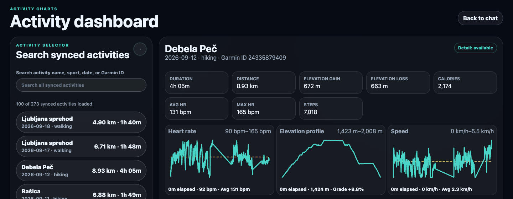

# AI Garmin Connect Trainer

A local-first training companion: import Garmin history, explore activity/recovery trends and chat with a coach grounded in your data.

- Trainer chat with streaming answers and guarded local SQL/math.
- Searchable Activity Dashboard and daily/weekly/monthly Health.
- Profile, General Plan, weekly plans/KPIs and inspectable cross-chat memory.
- ChatGPT subscription, OpenAI/DeepSeek API keys, loopback Ollama or explicit OpenRouter.

**Local-only, single-user, no app sign-in.** Do not expose it on LAN/public hosts/tunnels. Cloud models receive bounded context; local storage does not mean fully local AI processing. Garmin access uses your own official Personal API key, read-only; the new API may change and keys may expire/revoke.

Supported platform: **macOS ARM64**. [Downloads](https://github.com/codexa-bh/ai-garmin-trainer/releases) are unsigned/not notarized; macOS may refuse them. Do not disable OS protections. [Windows x64 alpha](docs/windows.md) is experimental/unsupported. See [release notes](release-notes/releases/).

## Screenshots

Actual operator-authorized desktop examples, not fixtures or coaching-accuracy guarantees. Captured 18 September 2026 at 1440px; Dashboard/Health crops preserve displayed values and may lag current UI.

### Trainer chat


Existing conversation excerpt; no prompt sent for capture.

### Activity Dashboard



### Daily Health


Coverage depends on Garmin; today's values may be incomplete.

### Monthly Health


## Installation

Tauri is the product launcher; Next.js is internal, not a browser launch path. Source setup is script-checked, not clean-machine certification. [Desktop](docs/desktop.md) owns details/recovery.

### 1. Install prerequisites and build

Install Git, Node 22+/npm, Xcode/CLT, Rust/Cargo and developer Python 3.12 ([pinned tools](docs/validation.md#local-tool-setup)). The app bundles Node, needs no Python/uv/uvx and does not install software/models or manage optional Ollama.

```bash
git clone https://github.com/codexa-bh/ai-garmin-trainer.git
cd ai-garmin-trainer
npm ci
npm run desktop:build
open 'src-tauri/target/aarch64-apple-darwin/release/bundle/macos/Garmin Trainer.app'
```

Clone needs no GitHub account; pushing needs authorization. Run commands in checkout. `desktop:dev` rebuilds production resources for native development, not HMR/browser server.

### 2. Enter Settings

First launch opens native Settings: Data → Provider → Connect Garmin or continue → Review. Create new DB or explicitly select existing data, configure chat and optionally Garmin. Keys live in owner-private **plaintext**, not encrypted storage. [Settings](docs/settings.md) owns controls; [adoption](docs/desktop.md#explicit-private-state-adoption) owns existing-data safety. Catalog/shared keys apply live only after acknowledgment; other settings require explicit quit/reopen.

### 3. Connect Garmin

Create a Personal API key in your Garmin browser account, enter it only in native Connect Garmin, Save/Finish and reopen. Sync → Garmin maintenance → Verify connection is the explicit check. Never paste keys into chat/issues/screenshots. See [connection](docs/garmin-auth.md) and [Sync](docs/sync-and-health.md).

### 4. Database upgrades (only when needed)

Desktop never migrates existing data automatically. Approve exact target, stop every owner, verify WAL-aware backup and rehearse on a disposable populated copy before separate primary mutation:

```bash
DATABASE_PATH='/absolute/approved/trainer.sqlite' npm run db:status -- --json
# Only for the explicitly approved stopped/backed-up target:
DATABASE_PATH='/absolute/approved/trainer.sqlite' npm run db:migrate
```

Migration uses process env, not dotenv. CLI doctor/status do not read native Settings/Keychain/Garmin key or contact Garmin; .env.example is maintenance reference, not onboarding. Preserve private env/output. [Data lifecycle](docs/source-beta-readiness.md) owns recovery; no automatic downgrade/reset/copy-back/browser fallback.

## Repository guide

Read only the changed area's owner:

- [Architecture](docs/architecture.md), [design](docs/design-choices-and-boundaries.md), [component index](docs/component-responsibilities.md).
- [Settings](docs/settings.md), [desktop](docs/desktop.md), [runtime/models](docs/local-runtime.md), [ChatGPT](docs/chatgpt.md).
- [Sync/Health](docs/sync-and-health.md), [Garmin fields/backfill](docs/garmin-extra-data.md), [key handling](docs/garmin-auth.md).
- [Memory](docs/memory.md), [summary protocol](docs/cross-chat-summary.md), [conversation history](docs/conversation-history.md).
- [Training Plan](docs/training-plan.md), [KPIs](docs/weekly-kpis.md), [coaching/sources](docs/coaching-instructions-and-sources.md).
- [Validation](docs/validation.md), [developer duties](docs/developer-process.md), [smoke playbook](docs/dev-bridge.md), [inputs](docs/smoke-inputs.md). Discover commands with `npm run smoke:help -- search <terms>`.
- [Release](docs/release.md), [note format](release-notes/README.md), [redistribution](docs/redistribution.md), [readiness/data lifecycle](docs/source-beta-readiness.md).

## Validation

After pinned setup, `npm run validate` runs quality checks/tests/build. [Validation](docs/validation.md) owns PR/main, change-gated native nightly and manual Windows recipes/limits. Build success proves neither authentication/provider readiness nor clean-machine setup. App behavior needs applicable actual smoke; docs-only work uses textual/consumer checks.

## Safety and privacy

Public source grants no hosting/deploy/release authority. Loopback is not protection from same-user processes. Model tools receive bounded normalized evidence, not credentials/auth rows/environment/filesystem access/raw dumps. User-authored topic words/URLs/path-like examples remain untrusted discussion, not native authority; provider handles medical responses without an extra app-authored restriction.

[Memory](docs/memory.md) explains lower-authority continuity and frozen per-turn use. Chat/Profile, Garmin, plans, generated memory/preferences and legacy stores have distinct deletion scopes; deleting chats does not clear saved memory, and Clear cannot recall exports/provider logs/backups. Read [data lifecycle](docs/source-beta-readiness.md#local-data-lifecycle) before destructive actions.

## License

Own code/assets, including earlier versions: [MIT](LICENSE). Dependencies, names/logos/maps retain their terms; [license scope](docs/redistribution.md#first-party-license).
