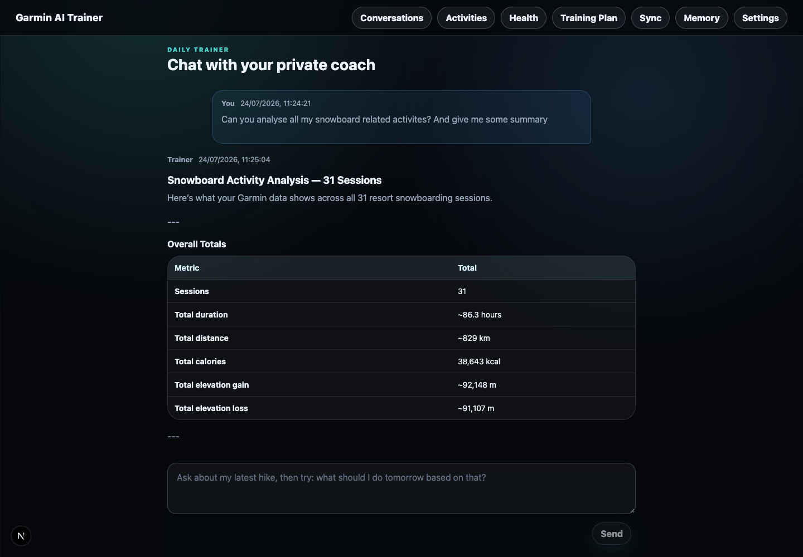
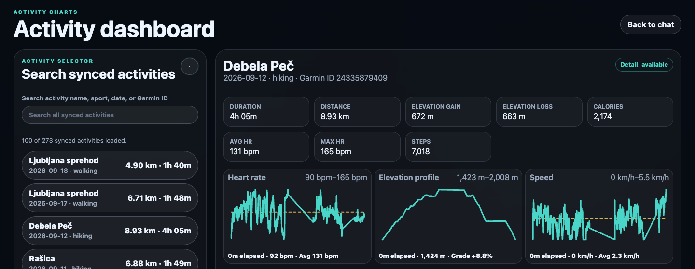
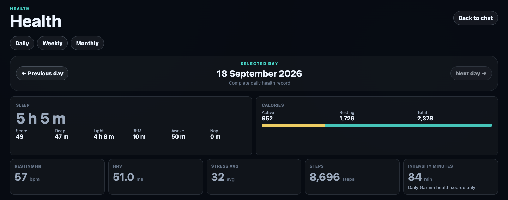
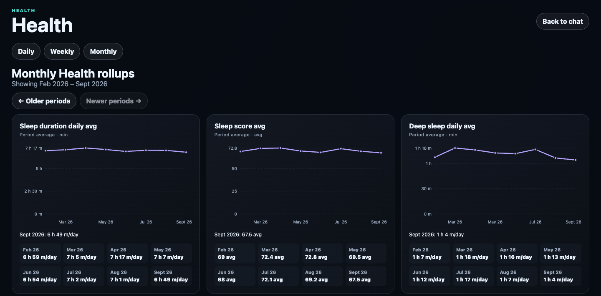

# AI Garmin Connect Trainer

A local-first training companion with public source: import your Garmin Connect history, explore activity and recovery trends, and chat with a coach grounded in your data.

- **Trainer chat** — streaming answers using normalized Garmin data, guarded read-only SQL/math tools, and conversation context.
- **Activity Dashboard** — searchable synced activities with summary stats, heart-rate, elevation, speed, and other available detail charts.
- **Health** — daily metrics plus weekly/monthly rollups for training and recovery context.
- **Personalization** — an editable Profile and General Plan, chat-confirmed weekly plans/reviews with original commitments and secondary history, and inspectable stable cross-chat memory with manual/Forget/Refresh controls, without embeddings.
- **Provider choice** — direct DeepSeek/OpenAI, explicit loopback Ollama chat, or opt-in OpenRouter. Cloud providers receive bounded chat/Garmin context; local storage does not mean all AI processing stays on your machine.

**Local-only, single-user, no app sign-in.** Run on loopback only; do not expose it on your LAN, a public host, or a tunnel. Garmin access uses a pinned **unofficial** connector, not Garmin's official Developer Program APIs; undocumented endpoints may change or stop working. The source repository is public; source availability is not a supported packaged release, deployment, or beta invitation.

[Installation](#installation) · [Desktop runtime guide](docs/local-runtime.md) · [Garmin authentication](docs/garmin-auth.md) · [Safety and privacy](#safety-and-privacy)

## Screenshots

Actual desktop views of the running local app with operator-authorized data. These are examples, not demo fixtures or guarantees of coaching accuracy. Click an image for full size.

### Trainer chat



A bounded excerpt from an existing conversation, with a structured answer based on imported activity history. No new prompt was sent for this capture.

### Activity Dashboard



Search synced activities and inspect available normalized detail. This crop shows the summary and charts above the route-map section.

### Daily Health



Browse imported daily health records; coverage and values depend on what Garmin provides. Today's values are not necessarily final.

### Monthly Health



Compare period averages with labeled charts and per-period values. Weekly rollups are available in the same view.

Captured on 18 September 2026 from the loopback development app at a 1440-pixel desktop width. Dashboard/Health images are cropped for focus; no displayed metrics were altered. Screenshots may lag later UI changes.

## Installation

The sole supported product is the **locally source-built macOS ARM64 Tauri app** with bundled Node. Standalone browser development/start/restart/bootstrap support has been removed, including its wrappers and automatic Ollama preparation. Next.js remains internal desktop rendering/backend/build technology, not a second product launch path. Other platforms are unsupported.

This advanced-user setup from the **public repository** is cross-checked against scripts, not clean-machine certification. Follow [desktop build, private-state adoption and recovery](docs/desktop.md) too. No installer distribution, signing, notarization or release channel is provided.

### 1. Install prerequisites and build

Install **Git, Node.js 22+ with npm, Xcode/Command Line Tools, Rust/Cargo, and Python 3.12-capable uv/uvx**. Optional Ollama stays separately managed. Desktop never installs external software/Python or starts/downloads models; uv may acquire locked Python packages on explicit integration use.

```bash
git clone https://github.com/codexa-bh/ai-garmin-trainer.git
cd ai-garmin-trainer
npm ci
npm run desktop:build
open 'src-tauri/target/aarch64-apple-darwin/release/bundle/macos/Garmin Trainer.app'
```

Source reads/clones need no GitHub account. Pushing requires repository authorization. Run source commands from the checkout. `desktop:dev` rebuilds production backend resources and opens the native development host; there is no browser dev server or HMR.

### 2. Enter Settings

First launch opens **Settings**, also available from the native app menu even without a working backend. Desktop no longer loads/selects/discovers env files or its old configuration pointer. Upgrading users must re-enter settings; original env files, DBs and tokens are not imported, moved, changed or deleted.

A genuinely blank installation opens a guided **Data → Provider → Connect Garmin or continue → Review** wizard. Explicitly choose **Create new database** (unused destination only) or **Use existing data** (compatible SQLite only). Native proposes an owner-private platform app-data destination outside the checkout. No history date is required: explicit Sync starts with recent data and continues older discovery in bounded batches. Under **Garmin history**, enable **Limit how far back to import** only to choose an explicit **Import from** date. The date is hidden while Off; turning the limit off and saving returns to automatic discovery after quit/reopen. Create new initializes the authoritative current schema in memory, then exclusively publishes the new file without overwriting files, sidecars or leases. Existing selection and ordinary startup never create, migrate or adopt a missing/old/corrupt/owned database.

Use canonical absolute paths, not aliases, shell expansion or cwd-relative paths. Custom new destinations need an existing owner-private parent. For existing data, first evaluate on a WAL-consistent populated disposable backup. Choose Connect Garmin or Continue without Garmin; configured-provider chat and saved/offline history do not require Garmin. Compatible saved connections remain selected internally without finding or moving token files.

Provider keys are entered only in the local settings window and stored by native code in an **owner-private plaintext settings file** (folder `0700`, file `0600`). This is not encryption: the same user, privileged processes and backups can read it. Reads show masked status, never saved values. Untouched fields keep prior keys. A fixed mask indicates saved presence, never the key’s length or value. Type or paste to replace; Backspace/Delete on the mask marks removal, applied only on explicit Save. Legacy Keychain settings require explicit one-time **Adopt referenced Keychain keys once**, or private re-entry of every configured slot. Startup/reads/saves never access Keychain; denied adoption does not auto-retry. Original settings and Keychain items remain unchanged. See [storage and recovery](docs/desktop.md#explicit-private-state-adoption). **Memory → Remember across chats** controls startup configuration, not deletion. Choose the shared memory/automatic-title model and memory size separately from Trainer’s chat model. Save, then explicitly quit/reopen to apply memory changes. Saving On does not undo an immediate Disable in Trainer → Memory. Legacy configuration and custom executable overrides remain preserved internally, without technical editors or a diagnostic status section in normal Settings.

- **Chat model catalog** groups compact Model ID rows under OpenAI, DeepSeek, Ollama and OpenRouter, with per-provider Add/Remove and shared key controls, and no configured default. Labels use provider / exact Model ID only; valid old names remain inert, round-trippable compatibility metadata with no name editor. Trainer remembers one explicit choice per selected SQLite DB. Keys are shared once per provider; no discovery or automatic fallback. New configurations require an explicit chat choice, even with one eligible entry.
- Ollama has equal catalog prominence; its loopback endpoint stays Advanced. Manage its daemon/models separately. OpenRouter remains explicit opt-in; review [privacy and tool-reliability limits](docs/local-runtime.md#opt-in-openrouter-chat).
- Explicit Save retains original settings and exact prior-choice compatibility inputs before retiring old defaults. Legacy auto projects only its determinable prior DeepSeek-first/OpenAI-by-key selection, never continuing failover. Extraction/title compatibility and embeddings stay independent.
- Direct OpenAI API billing/model availability is separate from Codex subscription access.

On a genuine first run, **Finish and open Trainer** validates local settings/required keys, saves private file settings and starts one verified owned backend in the same session. This proves local configuration, not remote funding/model/network availability; there is no provider probe, automatic fallback or automatic Garmin sync/login. Ollama remains separately managed. If setup fails, read the reported commit state: a published DB, saved settings or independently verified tokens are retained, not rolled back. **Retry opening saved Trainer** uses the committed configuration only; after interruption before settings commit, explicitly select the retained DB with Use existing data.

For an existing installation, **Save settings** commits privately, then live-applies only chat catalog and shared provider-key changes to the owned running backend. Confirm the reported result: Applied, saved/not applied, or saved/live outcome unknown. Reload reconciles active versus saved state without retrying Save. Other settings (including DB/account, endpoints and memory topology) still need explicit quit/reopen. A confirmed Save that changes effective startup-only settings still pending activation shows a dismissal-only **Restart required** dialog. Unchanged/repeated and live-only Saves do not repeat it, even with older pending changes; restoring active values does not require it. Dismissal never restarts the app. Ordinary saves never start/restart a backend or switch a live DB/account. Invalid/unsupported saved settings are preserved, never treated as blank-install authority. The trainer's independently saved model preference is preserved.

### 3. Garmin access

Choose **Connect Garmin** (or **Reconnect Garmin**) in trusted native Settings. The app chooses a fresh owner-private location outside source/bundle; no token folder setup is needed. Compatible saved connections remain selected where they are. Enter email/password and supported MFA privately there, never in trainer chat, screenshots or issues. Credentials remain transient; native owns cancellation and a 180-second timeout. Only independently verified tokens are published, without overwriting old stores. Choose **Use this verified connection**, then first-run Finish or ordinary Save and explicit quit/reopen. This is a draft selection, never a running account switch; published tokens survive later setup cancellation. This unofficial connector is not official OAuth; challenges/rate limits may prevent login. See [authentication and recovery](docs/garmin-auth.md).

Missing tools are reported at the requested Garmin action, not as a blanket Settings notice. Native sign-in needs **uv and installed Python 3.12**, not uvx. Sync/remote reads need **uvx (or the configured override)** and a compatible Python for the pinned connector (Python >=3.10); optional FIT helpers use uv/Python 3.12 only when needed. Desktop searches `/opt/homebrew/bin`, `/usr/local/bin`, `/usr/bin`, never your shell initialization. Install/manage the required tool/interpreter separately, then explicitly retry the action. Existing custom executable overrides remain preserved internally; Settings no longer exposes path editors. A launcher failure is not proof of missing Python or expired credentials; unknown causes stay unknown. Saved/offline data remains usable without these tools. Native Settings remains reachable from the app menu even without a backend. No automatic install, login or retry is performed.

Ordinary sync/FIT remains pinned read-only stdio with credential fallback stripping. Token-file metadata alone does not prove current authentication or expiry. A saved selection is **Configured — not verified**; new successful sign-in proves authentication only at that time, with pending activation reported separately. Garmin enables fresh Garmin data/coaching but does not gate chat or offline history. No app-access sign-in is required; Garmin login/sync is never automatic at startup.

### 4. Explicit non-serving maintenance only when needed

The retained `doctor`, `db:status` and private-terminal `garmin:auth` tools still use deliberately authored checkout env/process configuration; **they do not read private native Settings or legacy Keychain**. `.env.example` is now a maintenance CLI reference, not desktop onboarding. Do not overwrite existing private env files. Never paste their values or auth output into chat/issues.

For existing-data schema upgrades (or separately chosen CLI creation), quit every owner of the explicitly approved target, preserve a verified WAL-aware backup, rehearse on a disposable copy and obtain separate primary-mutation approval. Then use the existing discrete CLI, not desktop startup:

```bash
DATABASE_PATH='/absolute/approved/trainer.sqlite' npm run db:status -- --json
# Only after approving the exact stopped/backed-up target:
DATABASE_PATH='/absolute/approved/trainer.sqlite' npm run db:migrate
```

`db:migrate` uses process environment only, not dotenv; it may create the explicitly selected target or back up an old populated schema before upgrade. Keep path-bearing output private. No automatic downgrade, copy-back, reset, primary cutover or browser fallback. See [data lifecycle](docs/source-beta-readiness.md). Source delivery grants no app restart, installation or release.

### Optional: cross-chat memory and developer diagnostics

Native Settings → Memory offers **Remember across chats** (default Off), **Memory and automatic chat-title model** (default Unselected) and **Memory size (characters)** (default6000, range1000–20000). Choose an exact configured catalog entry independently of Trainer chat; minimized context may leave the device through that provider. A smaller, cheaper model is usually sufficient for summaries and titles. Saved memory can be included on all four configured chat routes. Summary Off does not disable future title processing. See [memory](docs/memory.md) for stable pins, manual Edit/Forget/Clear/Off/Refresh, explicit historical selection and restart-only native settings.

Ordinary chat no longer retrieves/ingests semantic vectors or requires an embedding key/daemon. Legacy records, vectors, markers and inactive settings remain preserved for local review, without lazy migration or automatic historical export. Optional Ollama chat remains independent and operator-managed. Existing schema19/20 requires an explicitly approved compatible schema21 transition, not automatic startup migration. Memory uses full frozen chat pins and debounced foreground activity/catch-up. Summary, title and local compaction operations have no application-imposed spending/attempt or tokenizer/capacity-qualification gates. The selected provider controls model capacity and may refuse a request; no clipping or fallback is substituted. Observed usage, known-price estimates, historical reservations and unknown costs remain distinct, not invoices.

Local debug traces are currently always enabled by tested application policy, regardless of `LLM_DEBUG_TRACES`. Traces visible in Profile & data may include private normalized Garmin/chat/tool context; keep them local and out of screenshots/support artifacts.

## Repository guide

Start with [architecture](docs/architecture.md), then read only the detailed docs relevant to your work:

- [Design choices and boundaries](docs/design-choices-and-boundaries.md) — component responsibilities, AI reasoning, guarded SQL/math, local storage, and import boundaries.
- [Coaching instructions and sources](docs/coaching-instructions-and-sources.md) — evidence, limitations, and instruction maintenance.
- [Memory](docs/memory.md) — stable cross-chat pins, manual/control UI, shared summary/title configuration and preserved legacy review; [conversation replay/compaction](docs/conversation-history.md) and [incremental summary](docs/cross-chat-summary.md) document owners/bounds. The [accepted redesign contract](docs/memory-redesign-contract.md) and [synthetic scenarios](docs/memory-redesign-acceptance.md) define evidence, not blanket passes. Schema20 and restart-only settings require separate activation; source delivery activates no primary data.
- [Validation](docs/validation.md) and [developer process](docs/developer-process.md) — local smoke, same-task data back-sync, and task-created data cleanup.
- [Local macOS desktop runtime](docs/desktop.md) — bundled resources, native lifecycle, private file settings/adoption, private sign-in, external integrations and rollback.
- [Local smoke inputs](docs/smoke-inputs.md) — representative authored synthetic defaults and optional exact reusable private authority; no personal-input discovery or recurring nightly expansion.
- [Programmatic native smoke](docs/dev-bridge.md) — explicit isolated ordinary-artifact navigation/Profile/save/restart and geometry-preserving redacted capture without normal settings/singleton contact; separate debug/CI-quick, finite Health and keyless native Settings scenarios, owned shutdown and separately labeled legacy release-denial evidence. Its [task-needed extension policy](docs/dev-bridge.md#task-needed-bridge-and-runner-extensions) makes bounded safe bridge/runner evolution expected, not a permanent capability ceiling.
- [Source readiness and data lifecycle](docs/source-beta-readiness.md) — supported boundary, backup/restore, diagnostics, and dependency evidence.

Key code entry points are `src/app/trainer-dashboard.tsx`, `src/app/style.css`, `src/app/api/`, `src/lib/ai/`, `src/lib/garmin/`, and `src/lib/memory/`.

## Runtime trainer model

Trainer navigation uses **Profile & data** for editable Profile, imported athlete/body facts, diagnostics and deletion. **Sync** owns connector verification, import-summary refresh and activity-detail maintenance; Memory remains separate.

Chat's compact **Model** selector (accessible name **Trainer model**) lists locally eligible activated catalog entries with provider/exact-ID labels. Missing-key cloud entries are omitted; eligible keyless Ollama entries remain. An unavailable selected identity stays explicit, never visually or persistently replaced by the first eligible choice. With no eligible entries, configure provider keys/models in native Settings, confirm live application and retry availability. Saving an eligible identity affects subsequent trainer turns without restarting; running turns retain their captured model/configuration. The app-wide preference persists across reloads/restarts. There is no Default/Reset action. Deleted/missing-key/invalid choices stay unavailable until explicitly replaced, with no provider-only remapping or silent substitution. One-time durable compatibility preserves prior exact saved/legacy/default intent without overwriting original preferences; a new configuration remains unselected.

Eligibility means local configuration, not account funding, installed models or remote readiness. The chat control never exposes/edits keys or changes the shared summary/title selection. Native Settings owns private updates; catalog/keys can apply live after exact acknowledgment. Captured chat, memory and deferred-title work retain their admitted credentials; other configuration stays restart-only. See [local runtime](docs/local-runtime.md#runtime-trainer-model-preference).

## Weekly plans and reviews

Training Plan opens to **This Week**, using your device's Monday–Sunday calendar. **Upcoming** exposes the following week (including plans prepared on Sunday); **General Plan** retains the existing independent manual editor. Saved general plans remain usable; more than 60 elapsed days since revision offers an optional review cue, not an expiry or automatic rewrite. **History** loads bounded summaries and individual past documents, not an entire archive.

Create or revise General Plan, weekly plans and reviews directly in chat using the general template, current Garmin evidence and your feedback. No mandatory preview or confirmation turn is required. Ask for **draft only, do not save** when you want discussion without persistence. Complete current reads, conflict/privacy/calendar checks and exact targeted edits still apply. A review and next plan save atomically together; a separate General Plan update is not part of that transaction. The trainer reports each actual save or failure.

New weekly drafts include model-selected KPIs with targets, units, evidence and explained full-target points totalling **100**. Reviews compare actuals with the **Original commitment** rubric and name its revision; latest adaptations remain separate context. Useful, relevant extra work can exceed 100, with explained partial substitution credit, no double-counting and unmet specific goals still visible (cycling kilometres are not hiking kilometres). There is no fixed app-authored scoring formula or score widget.

The **Original commitment** is the first saved weekly plan, retained as the review/scoring baseline; the latest copy includes later adaptations. When their titles and exact Markdown match, the duplicate original disclosure is hidden; differing originals remain available in a collapsed disclosure. Reopening Training Plan refreshes saved data without losing the selected tab, historical week or loaded history range. Entering General Plan also refreshes its saved snapshot; unsaved editor input survives navigation and refresh, and Cancel restores the current saved snapshot. Navigation never saves edits.

The first saved plan stays available as **Original commitment**; current/upcoming revisions update only the latest copy. Legacy plans without a rubric get clearly provisional assumptions grounded in recorded commitments, not targets invented from results. No recorded plan means no completion score; missing evidence is unavailable, not zero. Partial-week progress retains the original denominator, as-of cutoff and explicit gaps, not an unsupported definitive total. The displayed latest-plan snapshot at review save is contextual metadata, not necessarily the scored original.

Historical plans are read-only. Sunday is not automatically a finished week. Late evidence or corrections require fresh evidence and a newly saved review through chat; existing documents are not automatically rescored or rewritten. Saved date ranges/calendar bases never silently shift with a device timezone change. No workouts, background reminders, automatic saves or Garmin write-back are introduced.

Weekly artifacts and the general template survive chat/Profile and Garmin deletion. Chat deletion does not delete saved documents. Legacy pending proposal storage is preserved but is not exposed to the model or automatically applied. Schema upgrade is additive; use the explicit backed-up migration procedure above. Source delivery does not upgrade a running database automatically or authorize a restart.

## Daily-health freshness

**Sync latest** refreshes recent health/activity/body facts and baseline/detail supplements without advancing or resetting saved historical exploration. **Import older data** starts explicit exploration within the current automatic or selected scope; **Continue historical import** appears only for verified executable saved work. A history record or unknown remote boundary alone is not backlog. Completed selected ranges stay completed after repeat refresh/reload. Processed activity records and refreshed health dates are upsert counts, not proven new records; stored totals remain separate.

Historical import refreshes recent facts once and advances fair health/activity/body/repair batches in one foreground operation, up to **30 minutes or 480 cumulative remote-operation attempts**, with at least one second between serial dispatches. Each internal batch retains **96 attempts / 180 seconds**, each nested read **30 seconds**. MCP calls and local FIT-wrapper invocations are attempts, not exact Garmin HTTP counts or a proven service allowance. Startup, nested reads and pacing share the non-resetting operation clock. The trainer tool and bodyless legacy HTTP callers retain their existing bounded semantics; the dashboard always sends an explicit latest/history intent. Concise results and next work stay visible; collapsed **Technical details** holds sanitized logs and budget/cursor diagnostics.

A reviewed weekly-steps range read prioritizes positive candidate weeks; its minimized provenance is shown separately. Empty steps weeks never skip sleep/stress/battery reads or establish remote inception. Family cursors remain independent. **Cancel sync**, disconnect or app exit stops dispatch and owned work, retaining committed data. Restart and safety pauses require explicit **Continue historical import** when saved work is actionable; setup Finish, launch, navigation and summary reads never start discovery. Authentication/rate/protocol/storage failures and no safe progress stop automatic admission without retries. Refresh summary after cancellation/lost response before another action; failed/stale summary blocks replay. a live server claim still refuses overlap. Persisted running without a live claim is interrupted, not a permanent lock.

The durable summary separates checked older dates, dates with metrics, oldest imported date and unresolved work. Empty dates and activity exhaustion never prove earliest remote health: that boundary remains **unknown**. Existing valid saved dates remain optional advanced exploration limits (not coverage proof); clear the field and explicitly relaunch to select automatic discovery. Old global forward checkpoints are retained but never interpreted as reverse cursors. Family progress remains in `garmin_history_v1`; separate additive `garmin_discovery_v1` stores minimized hint provenance, queued candidate dates and historical operation phase/attempts/batches/stop reason. Additive `garmin_latest_v1` retains latest-refresh settlement/counters independently; summary reads never write checkpoints. Changed-scope/unsupported checkpoints and failed/no-progress history require recovery rather than an ordinary continuation invitation. Unsupported/corrupt checkpoints refuse rather than reset. Existing normalized records and date-keyed weight history are preserved. A source rollback can ignore the new checkpoint but must preserve DB/backups; the older exhaustive importer has its own behavior and is not a bounded-sync substitute.

Health **Daily** compares seven consecutive calendar dates as individual source
values, not a weekly aggregate. Previous/Next step seven dates (including gaps);
Latest returns to the newest imported date at or before today. The range survives
tabs, away/back and overlapping post-sync refreshes. Missing records/fields and
outside-loaded history are explicit, and today is marked in progress on the UTC
sync calendar. Responsive metric charts retain all seven date slots, with exact
source values available by pointing to, focusing or tapping the date buttons.
Collapsed per-date details preserve source coverage and categorical HRV context;
gaps are not interpolated or filled with zero. Weekly/Monthly calculations and their bounded imported input remain unchanged.

Complete daily-health coverage does not mean final totals. Each sync refreshes today and yesterday on the existing UTC sync calendar. Within the inclusive 14-day trailing window, older complete dates refresh when any stats, sleep, or body-battery fetch evidence is missing or at least 24 hours old. Missing/partial trailing dates still retry every run; historical gap/repair and checkpoint backfill remain separate. This costs at most 42 trailing tool calls per sync, normally six for repeated complete data within 24 hours. Refreshes preserve prior non-null fields when Garmin omits them and accept valid zero/downward corrections. Delayed uploads outside the window may still require a targeted re-sync; source agreement does not prove finality.

## Validation

Run `npm run validate` for all static/deterministic checks and the production build. Routine Ubuntu PR/main CI uses `validate:ci` without production/native builds; a change-gated 02:17 UTC macOS ARM64 nightly adds full validation/reliability/resources/native tests and one synthetic Goals save/restart. Exact reproduction, unchanged-failure skip policy and coverage limits are documented in [validation](docs/validation.md). A successful build is not proof of working Garmin authentication, remote-provider readiness, or clean-machine setup.

## Safety and privacy

- Source is publicly available at `https://github.com/codexa-bh/ai-garmin-trainer`. Public source availability does not authorize public hosting, LAN exposure, deployment, release, or beta invitations; local data and credentials must remain private.
- Local app access has no sign-in gate; loopback/private operation and local secret handling are required.
- Garmin access is local-only through stdio to a pinned unofficial connector; HTTP transport and connector write operations are not used.
- The selected cloud AI provider receives bounded chat/Garmin context. Review provider privacy/routing settings; local SQLite storage is not an assurance of fully local processing.
- The trainer sees app-normalized summaries and bounded current-turn SQL/math or detail-tool evidence; it never sees Garmin credentials, token/auth/cookie fields, connector config, environment values, filesystem paths, unrestricted raw payloads, or unrestricted stream dumps.
- The configured AI provider handles medical-domain responses without an additional app-authored response restriction; diagnosis and treatment content is still excluded from durable personalization memory.
- Profile, active chat transcript, Garmin facts, summary derivatives and preserved legacy memory are separate. New chat resets local context and freezes latest usable cross-chat memory or null. Summaries remain lower authority than current corrections, Profile and fresh tool evidence; ordinary publication does not replace existing pins. Inspect, manual Edit/Forget, Clear, Disable and explicit Refresh retain distinct scope.
- Clear chat/Profile, Clear summary and Garmin deletion are separate controls; transcripts, plans, legacy stores, provider logs and backups are not erased by summary Clear. See [data lifecycle](docs/source-beta-readiness.md#local-data-lifecycle) and [memory](docs/memory.md) before deleting data or resetting Garmin access.
