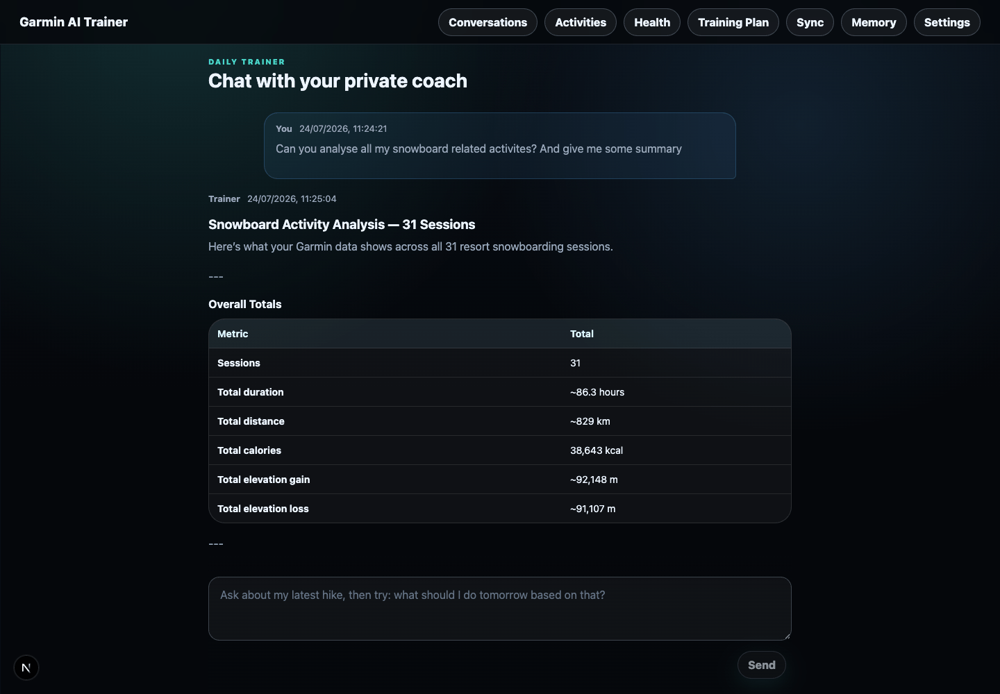
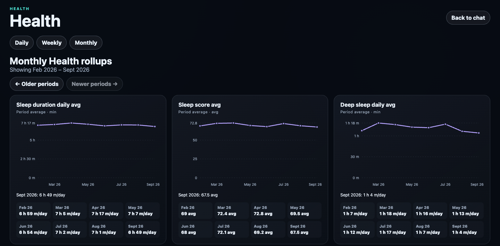

# AI Garmin Connect Trainer

A local-first training companion with public source: import your Garmin Connect history, explore activity and recovery trends, and chat with a coach grounded in your data.

- **Trainer chat** — streaming answers using normalized Garmin data, guarded read-only SQL/math tools, and conversation context.
- **Activity Dashboard** — searchable synced activities with summary stats, heart-rate, elevation, speed, and other available detail charts.
- **Health** — daily metrics plus weekly/monthly rollups for training and recovery context.
- **Personalization** — an editable Profile and General Plan, chat-maintained weekly plans and reviews, and an inspectable cross-chat memory summary.
- **Provider choice** — ChatGPT subscription, OpenAI or DeepSeek API keys, explicit loopback Ollama, or opt-in OpenRouter. Cloud providers receive bounded chat/Garmin context; local storage does not mean all AI processing stays on your machine.

**Local-only, single-user, no app sign-in.** Run on loopback only; do not expose it on your LAN, a public host, or a tunnel. Garmin data comes from Garmin's official **Personal API** with a key you create for your own account; it is a new API that may change, and a key can expire or be revoked. The supported platform is **macOS ARM64**; published downloads are on [GitHub Releases](https://github.com/codexa-bh/ai-garmin-trainer/releases), with notes in [`release-notes/releases/`](release-notes/releases/).

[Installation](#installation) · [Settings guide](docs/settings.md) · [Garmin connection](docs/garmin-auth.md) · [Safety and privacy](#safety-and-privacy)

## Screenshots

Actual desktop views of the running local app with operator-authorized data. These are examples, not demo fixtures or guarantees of coaching accuracy. Click an image for full size.

### Trainer chat



A bounded excerpt from an existing conversation, with a structured answer based on imported activity history. No new prompt was sent for this capture.

### Activity Dashboard


Search synced activities and inspect available normalized detail. This crop shows the summary and charts above the route-map section.

### Daily Health


Browse imported daily health records; coverage and values depend on what Garmin provides. Today's values are not necessarily final.

### Monthly Health



Compare period averages with labeled charts and per-period values. Weekly rollups are available in the same view.

Captured on 18 September 2026 from the loopback development app at a 1440-pixel desktop width. Dashboard/Health images are cropped for focus; no displayed metrics were altered. Screenshots may lag later UI changes.

## Installation

The supported product is the **local macOS ARM64 Tauri app** with bundled Node; Next.js is its internal rendering/backend technology, not a separate browser launch path. You can build from source as below or use a published DMG: published binaries are **unsigned and not notarized**, and macOS may refuse to open them. Do not disable OS protection to get around that. Windows x64 alpha installers are published as an experimental build outside the supported platform; see [Windows alpha limits](docs/windows.md). This advanced-user setup is cross-checked against scripts, not clean-machine certification. [Desktop runtime](docs/desktop.md) owns build details, [private-state adoption](docs/desktop.md#explicit-private-state-adoption) and recovery.

### 1. Install prerequisites and build

Install **Git, Node.js 22+ with npm, Xcode/Command Line Tools, Rust/Cargo**, plus Python 3.12 only for the developer build/validation scripts (see [local tool setup](docs/validation.md#local-tool-setup)). The app itself needs no Python, uv or uvx: Garmin access and activity-file decoding run inside its bundled Node. Optional Ollama stays separately managed. Desktop never installs external software or starts/downloads models.

```bash
git clone https://github.com/codexa-bh/ai-garmin-trainer.git
cd ai-garmin-trainer
npm ci
npm run desktop:build
open 'src-tauri/target/aarch64-apple-darwin/release/bundle/macos/Garmin Trainer.app'
```

Source reads/clones need no GitHub account. Pushing requires repository authorization. Run source commands from the checkout. `desktop:dev` rebuilds production backend resources and opens the native development host; there is no browser dev server or HMR.

### 2. Enter Settings

First launch opens native **Settings** (also in the app menu, even without a working backend). A blank installation walks through **Data → Provider → Connect Garmin or continue → Review**: choose **Create new database** or **Use existing data**, enter at least one chat provider, then connect Garmin or continue without it. Provider keys are stored in an owner-private **plaintext** settings file (not encryption). The [Settings guide](docs/settings.md) covers model choice, memory and [Save versus restart](docs/settings.md#save-and-activation).

### 3. Connect Garmin

Create a **Personal API key** in Garmin Connect (Settings → Personal API key) in your own browser, choose **Connect Garmin** in native Settings, paste it and Save (first run: Finish), then quit and reopen. **Sync → Garmin maintenance → Verify connection** is the only explicit key check. Keep the key out of chat, screenshots and issues. See [Garmin connection and key handling](docs/garmin-auth.md); Sync and history import are described in [Sync and Health](docs/sync-and-health.md).

### 4. Database upgrades (only when needed)

The retained `doctor` and `db:status` tools use deliberately authored checkout env/process configuration; **they do not read private native Settings, the Garmin key or legacy Keychain**, and never contact Garmin. `.env.example` is a maintenance CLI reference, not desktop onboarding. Do not overwrite existing private env files. Never paste their values into chat/issues.

For existing-data schema upgrades (or separately chosen CLI creation), quit every owner of the explicitly approved target, preserve a verified WAL-aware backup, rehearse on a disposable copy and obtain separate primary-mutation approval. Then use the existing discrete CLI, not desktop startup:

```bash
DATABASE_PATH='/absolute/approved/trainer.sqlite' npm run db:status -- --json
# Only after approving the exact stopped/backed-up target:
DATABASE_PATH='/absolute/approved/trainer.sqlite' npm run db:migrate
```

`db:migrate` uses process environment only, not dotenv; it may create the explicitly selected target or back up an old populated schema before upgrade. Keep path-bearing output private. No automatic downgrade, copy-back, reset, primary cutover or browser fallback. See [data lifecycle](docs/source-beta-readiness.md).

## Repository guide

Read only what your change touches:

| Area                                   | Start here                                                                                                                                                                                            |
| -------------------------------------- | ----------------------------------------------------------------------------------------------------------------------------------------------------------------------------------------------------- |
| Design principles and boundaries       | [Design choices](docs/design-choices-and-boundaries.md), then [component responsibilities](docs/component-responsibilities.md)                                                                        |
| Code structure                         | [Architecture overview](docs/architecture.md) and its area guides                                                                                                                                     |
| Settings, model choice, memory options | [Settings guide](docs/settings.md), [memory](docs/memory.md), [cross-chat summary](docs/cross-chat-summary.md), [conversation history](docs/conversation-history.md)                                  |
| Sync, history import, Health views     | [Sync and Health](docs/sync-and-health.md), [additional Garmin data](docs/garmin-extra-data.md), [Garmin connection](docs/garmin-auth.md)                                                             |
| Training Plan and KPIs                 | [Training Plan](docs/training-plan.md), [weekly KPIs](docs/weekly-kpis.md)                                                                                                                            |
| Coaching prompts                       | [Coaching instructions and sources](docs/coaching-instructions-and-sources.md)                                                                                                                        |
| Native runtime and providers           | [Desktop runtime](docs/desktop.md), [local runtime](docs/local-runtime.md), [ChatGPT subscription](docs/chatgpt.md), [Windows alpha](docs/windows.md)                                                 |
| Validation, smoke and developer duties | [Validation](docs/validation.md), [developer process](docs/developer-process.md), [smoke playbook](docs/dev-bridge.md) (`npm run smoke:help -- search <terms>`), [smoke inputs](docs/smoke-inputs.md) |
| Release                                | [Release runbook](docs/release.md), [release notes](release-notes/README.md), [redistribution](docs/redistribution.md)                                                                                |
| Data lifecycle and support             | [Source readiness and data lifecycle](docs/source-beta-readiness.md)                                                                                                                                  |

Key code entry points are `src/app/trainer-dashboard.tsx`, `src/app/api/`, `src/lib/ai/`, `src/lib/garmin/` and `src/lib/memory/`.

## Validation

After the [pinned Python/Rust tool setup](docs/validation.md#local-tool-setup), run `npm run validate` for JS/TS, Rust format and Python format/lint/dead-code checks, deterministic tests and the production build. Routine Ubuntu PR/main CI uses `validate:ci` (including both Knip modes) without production/native builds; a manual-only `Windows x64` workflow builds/verifies the Windows foundation and runs the finite synthetic installed-render/persistence/uninstall scenario on Windows Server (not Windows 11 qualification); a change-gated 02:17 UTC macOS ARM64 nightly adds full validation/reliability/resources, warnings-denied Clippy, native tests and one synthetic Goals save/restart. Clippy is macOS-only and post-merge; Windows-only Rust is formatted but not linted. Exact reproduction, unchanged-failure skip policy and coverage limits are documented in [validation](docs/validation.md). A successful build is not proof of working Garmin authentication, remote-provider readiness, or clean-machine setup.

## Safety and privacy

- Source is publicly available at `https://github.com/codexa-bh/ai-garmin-trainer`. Public source availability does not authorize public hosting, LAN exposure, deployment, release, or beta invitations; local data and credentials must remain private.
- Local app access has no sign-in gate; loopback/private operation and local secret handling are required.
- Garmin access is read-only HTTPS to Garmin's fixed official Personal API origin with the user's own key; no Garmin writes, redirects, alternate endpoints or connector processes.
- The selected cloud AI provider receives bounded chat/Garmin context. Review provider privacy/routing settings; local SQLite storage is not an assurance of fully local processing.
- The trainer sees app-normalized summaries and bounded current-turn SQL/math or detail-tool evidence; it never sees the Garmin key, bearer tokens, token/auth/cookie fields, environment values, filesystem paths, unrestricted raw payloads, or unrestricted stream dumps.
- The configured AI provider handles medical-domain responses without an additional app-authored response restriction. Cross-chat memory has no content-pattern filter: user-authored topic words, URLs, paths, key-like strings and quoted instructions may remain untrusted discussion data, never native credential/file/tool authority. Structure, source scope and explicit no-save/privacy controls still apply.
- Profile, active chat transcript, Garmin facts, summary derivatives and preserved legacy memory are separate. New chat resets local context; each turn's admission adopts latest usable cross-chat memory or null. Summaries remain lower authority than current corrections, Profile and fresh tool evidence; ordinary publication cannot replace an in-flight snapshot. Whole-summary editing, separate preference removal, Clear and Disable retain distinct scope; no precise per-source generated-fact erasure is promised.
- Clear chat/Profile, Clear summary and Garmin deletion are separate controls; transcripts, plans, legacy stores, provider logs and backups are not erased by summary Clear. See [data lifecycle](docs/source-beta-readiness.md#local-data-lifecycle) and [memory](docs/memory.md) before deleting data or resetting Garmin access.

## License

The project's own code and assets are available under the [MIT License](LICENSE), including earlier versions. Dependencies and third-party names, logos and map data keep their own terms; see [what the license covers](docs/redistribution.md#first-party-license).
